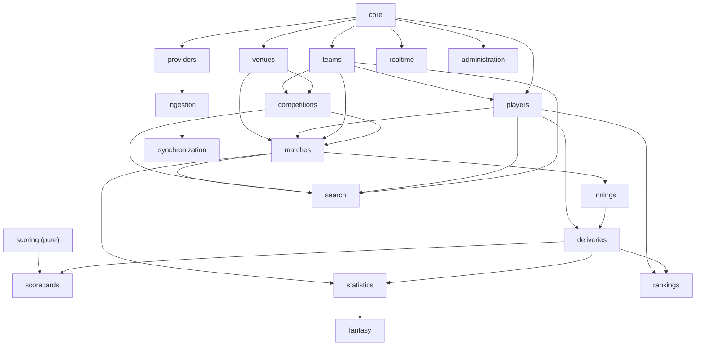

# CRICKET_BACKEND_ARCHITECTURE.md

Recommended backend architecture: a **modular monolith** in **Django + Django
REST Framework**, with **PostgreSQL**, **Redis**, **Celery**, and
**WebSockets/SSE** for real-time delivery. Modules are explicit Django apps with
enforced dependency rules so the system can later be split if — and only if —
measurable load justifies it.

---

## 1. Technology evaluation

| Concern | Choice | Rationale | Alternative considered |
|---|---|---|---|
| Language/framework | **Python + Django** | Batteries-included ORM, admin, migrations, huge cricket-stats ecosystem, fast for a small team | Node/NestJS, Go |
| API | **Django REST Framework** | Serializers, pagination, permissions, throttling, browsable API | FastAPI (fewer batteries; would lose Django admin) |
| DB | **PostgreSQL 16** | Relational integrity, `jsonb`, partitioning, numeric, window functions | MongoDB (weaker integrity), ClickHouse (only for a future analytics tier) |
| Cache | **Redis 7** | Cache + Celery broker + pub/sub for realtime fan-out + rate limiting | Memcached (no pub/sub/structures) |
| Async jobs | **Celery** (+ beat) | Mature, retries/backoff, dead-letter via custom task | RQ, Dramatiq |
| Real-time | **Django Channels (WebSocket)** primary; **SSE** for simple one-way | Fan-out over Redis channel layer; SSE simpler for scoreboards | Long-polling (fallback only) |
| Search | **PostgreSQL trigram** first; **OpenSearch** only when needed | Avoid extra infra early | Elasticsearch |
| Time-series (future) | TimescaleDB/ClickHouse **only if** measurable need | Deliveries partition fine for years | — |

**Explicitly rejected for now:** microservices, Kafka, Kubernetes — no measured
requirement in the capacity scenarios justifies their operational cost.

---

## 2. Modular monolith — module catalog

Each row is one Django app under `apps/`. "Layer" shows which of the six layers
the module primarily owns (§4).

| Module | Responsibility | Owns (domain models) | Services / selectors | Publishes | Depends on |
|---|---|---|---|---|---|
| `core` | Base models, enums, UUIDv7, config, logging, pagination, error envelope, time utils, **cache layer** (key-versioned read-through), **streaming protocols**, **throttling + connection limiter**, **metrics** | `TimeStampedModel`, enums | mixins, `RuleConfig` registry, `cache` (store/keys/policy/invalidation/purger), `streaming` (protocols), `throttling`, `metrics` | — | — |
| `teams` | Teams, memberships, squads | `Team`, `TeamMembership`, `Squad`, `SquadMember` | `team_service`, `squad_service`; `team_selector` | `team.updated` | `core`, `venues` |
| `players` | Player identity, profiles, registry mapping, merges, duplicate review | `Player`, `PlayerMerge`, `PlayerDuplicateCandidate` | `player_service`, `identity_resolution`; `player_selector` | `player.updated`, `player.merged` | `core`, `teams` |
| `venues` | Venues, grounds, countries, governing bodies | `Venue`, `Ground`, `Country`, `GoverningBody` | `venue_service` | `venue.updated` | `core` |
| `competitions` | Competitions, seasons, series, stages, per-format rules | `Competition`, `Season`, `Series`, `MatchStage`, `FormatCatalogue` | `series_service`; `series_selector` | `series.updated` | `core`, `teams` |
| `matches` | Match aggregate, participation, toss, officials, results, awards, durable per-match event log | `Match`, `MatchTeam`, `Toss`, `MatchPlayer`, `MatchOfficial`, `MatchResult`, `MatchAward`, `MatchEventLog` | `match_service`, `result_service`, `event_log`; `match_selector` | `match.updated`, `match.state_changed`, `match.completed` | `core`, `competitions`, `teams`, `players`, `venues` |
| `innings` | Innings lifecycle, innings-level events (retirements/resume without a ball) | `Innings`, `InningsSummary`, `InningsEvent` | `innings_service`; `innings_selector` | `innings.updated` | `matches` |
| `deliveries` | Ball-by-ball facts, overs | `Delivery`, `Over` | `delivery_service` (append/idempotent); `delivery_selector` | `delivery.appended`, `delivery.corrected` | `innings`, `players` |
| `scorecards` | Derived card read-models + rebuild orchestration | `BattingEntry`, `BowlingEntry`, `FallOfWicket`, `Partnership` | `scorecard_service.rebuild`; `scorecard_selector` | `scorecard.updated` | `deliveries`, `scoring` |
| `statistics` | Per-match & career/team aggregates, leaderboards, H2H, form | `PlayerMatchStat`, `PlayerCareerStat`, `TeamStat`, `HeadToHead`, `Leaderboard`, `FormTrend` | `stats_service.rebuild`; `stats_selector` | `stats.updated` | `deliveries`, `matches` |
| `rankings` | ICC rankings (provider-supplied) | `PlayerRanking` | `ranking_service`; `ranking_selector` | `ranking.updated` | `core`, `players` |
| `fantasy` | Optional fantasy scoring | Fantasy tables (§ domain model 5) | `fantasy_service.compute`; `fantasy_selector` | `fantasy.computed` | `statistics`, `matches` |
| `providers` | Provider registry, entity maps, adapters registry, identity resolution | `DataProvider`, `ProviderEntityMap` | `provider_registry`, `providers.services.resolve` (generic resolver registry), adapters (`adapters/`) | `provider_map.verified` | `core` |
| `ingestion` | Fetch → validate → resolve → persist pipeline | `ImportJob`, `IngestionError` | `ingest_*` tasks, validators | `ingestion.completed`, `ingestion.failed` | `providers`, all domain modules |
| `synchronization` | Checkpoints, reconciliation, corrections, fixture sync | `SyncCheckpoint`, `ReconciliationJob`, `DataCorrection` | `sync_service`, `reconcile_service`, `fixtures.sync_fixtures` | `correction.applied` | `providers`, `ingestion` |
| `live` | Live ingestion surface: polling, push receiver, breaker, fixture window orchestration | (no models — writes through `matches`/`deliveries`) | `apply_batch`, `polling`, `receiver`, `breaker`, `verify` | `delivery.appended`, `delivery.corrected`, `match.state_changed` | `core`, `matches`, `deliveries`, `synchronization`, `providers`, `ingestion` (DLQ reporters) |
| `search` | Cross-entity search & filtering | (no models; index tables/projections) | `search_service` | — | `teams`, `players`, `competitions`, `matches` |
| `realtime` | WebSocket/SSE fan-out, subscriptions; consumes the `MatchEventLog` stream produced by Phase D through `core` protocols (hub, broker, frames, security, wiring) | `Subscription` (ephemeral) | `hub` (coalescing/backpressure/gap-recovery/drain), `broker` (Redis pub/sub + degraded polling), `sse`, `consumers`, `security` (Origin/caps), `routing` | domain events → client | `core` only (reader/policy injected by the composition root, `config/asgi.py`) |
| `scoring` | Pure cricket rule engine (see Phase 5) | (pure functions; no models) | `engine`, `laws`, `standings`, `results`, `dls` | — | `core` |
| `administration` | Admin, audit, ops dashboards | `AuditLog` | `admin_service` | `audit.recorded` | `core` |

---

## 3. Module dependency diagram (Mermaid)



**Dependency rule:** dependencies point **downward/inward** only. `scoring` is
pure (imports nothing but `core` types). No module imports `ingestion`,
`realtime` or `administration`. `search` reads from domain selectors, never the
reverse. Cross-module writes go through the owning module's service (e.g.
`deliveries` never writes `batting_entry` directly; it publishes
`delivery.appended` and `scorecards` consumes it). This keeps boundaries real.

**Event subscribers (tiered).** `scorecards` (plus Tier 1 cache invalidation and
the `realtime` publisher) consume `delivery.appended` / `delivery.corrected`.
`statistics` and `fantasy` subscribe to **`match.completed`** and
**`correction.applied`** (and scheduled jobs) — **never** to
`delivery.appended` — so a live ball never triggers career/team/fantasy
recomputation. See [CRICKET_SCORING_RULES.md §6](CRICKET_SCORING_RULES.md).

---

## 4. Six-layer separation

1. **Domain logic** — `apps/<module>/services/` (write) + `apps/<module>/laws/`
   (pure rules). No ORM in `laws/`.
2. **Database access** — `apps/<module>/selectors/` (read-optimised queries,
   `select_related`/`prefetch_related`, no business rules) + models.
3. **API serialization** — `apps/<module>/api/serializers.py`, `views.py`,
   `urls.py` (DRF).
4. **Provider integrations** — `apps/providers/adapters/<provider>.py`
   implementing a common `ProviderAdapter` interface (Phase 8).
5. **Background jobs** — `apps/<module>/tasks.py` (Celery).
6. **Real-time delivery** — `apps/realtime/consumers.py`, `apps/realtime/sse.py`.

---

## 5. Recommended directory structure

```
cricket_os/
  manage.py
  pyproject.toml
  config/
    settings/{base,dev,prod,test}.py
    urls.py
    asgi.py            # composition root: HTTP + WebSocket + lifespan (realtime wiring)
    celery.py
  apps/
    core/
      models.py        # TimeStampedModel, UUIDv7 default, enums
      pagination.py
      errors.py        # error envelope
      logging.py
      uuid7.py
      cache/           # read-through cache: store, keys, policy, invalidation, purger
      streaming.py     # realtime protocols (EventLogReader, StreamInfo, MatchPolicy)
      throttling.py    # token buckets (fail-open) + connection limiter
      metrics.py       # in-process metrics facade
    players/
      models.py
      selectors/players.py
      services/profile.py
      api/{serializers,views,urls,filters}.py
      tasks.py
      tests/
    # ... one package per module from §2 ...
    scoring/
      laws/wides.py, laws/overs.py, laws/dismissals.py
      engine.py
      aggregates.py
      standings.py
      results.py
      dls.py
      config.py
    providers/
      registry.py
      base.py           # ProviderAdapter protocol
      adapters/entitysport.py, adapters/cricsheet.py, adapters/cricapi.py
      adapters/replay.py  # ReplayAdapter: recorded matches through the live pipeline (test/dev)
    ingestion/
      pipeline.py
      validators.py
      normalizers.py
      tasks.py
    realtime/
      hub.py           # fan-out: coalescing, backpressure, gap/backfill, drain
      broker.py        # Redis pub/sub → hub, degraded polling, recovery
      frames.py        # frame model + codec
      security.py      # shared Origin/caps/resume policy (SSE + WS)
      sse.py           # SSE transport
      consumers.py     # WebSocket transport
      routing.py       # websocket_urlpatterns
      wiring.py        # composition hooks (injected, never imported)
  tests/
    conftest.py
    factories/
    e2e/
  docs/                 # this package
```

### Cross-cutting conventions

- **Layering enforced by import-linter** contracts in CI (forbid
  `selectors -> services`, forbid `api -> adapters`, etc.).
- **Event bus**: an in-process `django.dispatch`/`publish(topic, payload)` for
  synchronous in-transaction events and Celery for async fan-out.
- **Transactions**: writes use `transaction.atomic()`; events are published
  *after commit* (`transaction.on_commit`) so consumers never see rolled-back
  data.
- **Idempotency**: every ingestion write is keyed (§ Phase 8).

---

## 6. Per-module testing strategy

| Module | Focus | Representative tests |
|---|---|---|
| `core` | UUIDv7 monotonicity, error envelope, pagination | unit |
| `teams`/`players`/`venues` | model constraints, de-dup, membership temporality | model + integration |
| `competitions`/`matches` | schedule, status transitions, result | integration |
| `innings`/`deliveries` | append idempotency, ordering, out-of-order rejection | integration |
| `scoring` | **pure rule unit tests** (Phase 5 §5) + property-based | unit + hypothesis |
| `scorecards`/`statistics` | rebuild determinism, revision bumping | integration |
| `rankings`/`fantasy` | ruleset versioning, recompute audit | integration |
| `providers`/`ingestion` | adapter contract tests with recorded fixtures, idempotency, DLQ | contract + integration |
| `synchronization` | reconciliation, corrections replay | integration |
| `search` | query correctness, ranking | integration |
| `realtime` | event delivery, reconnect, last-event reconciliation | integration/e2e |
| `administration` | audit immutability, RBAC | integration |

See [CRICKET_TESTING_STRATEGY.md](CRICKET_TESTING_STRATEGY.md).

---

## 7. Why a modular monolith first

- A small team ships faster with one deployable and one database.
- The domain has **heavy internal coupling** (a delivery affects standings,
  stats, fantasy, and realtime) — microservices would create chatty, eventually
  consistent boundaries for little benefit.
- Clear module boundaries + an event interface make a future extraction
  mechanical (e.g. `statistics` and `search` are the first candidates to split
  under load).
- Scaling is addressed first with caching, read replicas and partitioning
  ([CRICKET_PERFORMANCE_AND_SCALING.md](CRICKET_PERFORMANCE_AND_SCALING.md)),
  which are far cheaper than distribution at these capacities.
