# CRICKET_DATABASE_SCHEMA.md

PostgreSQL design for Cricket OS: ER diagram, DDL, indexing, partitioning, and
the required edge-case explanations. Entity semantics are defined in
[CRICKET_DOMAIN_MODEL.md](CRICKET_DOMAIN_MODEL.md).

---

## 1. Primary-key strategy (justification)

**Decision: internal PK = `uuid` holding a UUIDv7** (time-ordered, generated in
the application layer), stored natively as `uuid`.

Why UUIDv7 and not serial/bigint or UUIDv4:

- **No information leak / easy sharding**: IDs are not guessable and do not
  reveal counts.
- **Time-ordered locality**: v7's leading timestamp keeps B-tree inserts
  near-sequential, avoiding the index-fragmentation penalty of v4, while
  remaining globally unique across services.
- **Provider IDs preserved separately**: provider identifiers live in dedicated
  `provider_*_id` columns and the `provider_entity_map` table, never as PKs, so
  a provider change cannot break referential integrity.

Use `gen_random_uuid()` (v4) only as a fallback; production inserts generate v7
in Python (`uuid_utils` / `uuid7`). Partitioned tables use a composite PK
`(id, match_date)` (PostgreSQL requires the partition key in the PK).

---

## 2. ER diagram (Mermaid)

```mermaid
erDiagram
  COUNTRY ||--o{ TEAM : home_of
  COUNTRY ||--o{ PLAYER : birth_of
  COUNTRY ||--o{ VENUE : located_in
  GOVERNING_BODY ||--o{ TEAM : governs
  VENUE ||--o{ GROUND : contains
  VENUE ||--o{ MATCH : hosts
  FORMAT_CATALOGUE ||--o{ MATCH : classifies

  TEAM ||--o{ TEAM_MEMBERSHIP : has
  PLAYER ||--o{ TEAM_MEMBERSHIP : joins
  TEAM ||--o{ SQUAD : names
  SQUAD ||--o{ SQUAD_MEMBER : includes
  PLAYER ||--o{ SQUAD_MEMBER : in

  COMPETITION ||--o{ SEASON : has
  COMPETITION ||--o{ SERIES : has
  SEASON ||--o{ SERIES : within
  SERIES ||--o{ MATCH : schedules
  SERIES ||--o{ MATCH_STAGE : organises
  SERIES ||--o{ TOURNAMENT_STANDINGS : ranks

  MATCH ||--o{ MATCH_TEAM : involves
  TEAM ||--o{ MATCH_TEAM : plays
  MATCH ||--o{ MATCH_PLAYER : fields
  PLAYER ||--o{ MATCH_PLAYER : appears
  MATCH ||--|| TOSS : has
  MATCH ||--o{ MATCH_OFFICIAL : officiated_by
  MATCH ||--o| MATCH_RESULT : resolves
  MATCH ||--o{ MATCH_AWARD : awards
  MATCH ||--o{ MATCH_EVENT_LOG : logs

  MATCH ||--o{ INNINGS : contains
  INNINGS ||--o{ OVER : groups
  INNINGS ||--o{ DELIVERY : has
  OVER ||--o{ DELIVERY : contains
  INNINGS ||--o{ BATTING_ENTRY : "batting card"
  INNINGS ||--o{ BOWLING_ENTRY : "bowling card"
  INNINGS ||--o{ FALL_OF_WICKET : records
  INNINGS ||--o{ PARTNERSHIP : records
  INNINGS ||--o| INNINGS_SUMMARY : summarised_by
  INNINGS ||--o{ INNINGS_EVENT : records
  PLAYER ||--o{ INNINGS_EVENT : subject_of

  PLAYER ||--o{ PLAYER_MATCH_STAT : stat_line
  MATCH ||--o{ PLAYER_MATCH_STAT : from
  PLAYER ||--o{ PLAYER_CAREER_STAT : aggregates
  TEAM ||--o{ TEAM_STAT : aggregates
  PLAYER ||--o{ PLAYER_RANKING : ranked
  PLAYER ||--o{ FORM_TREND : trend
  PLAYER ||--o{ PLAYER_MERGE : merged_into
  PLAYER ||--o{ PLAYER_DUPLICATE_CANDIDATE : "candidate_of"
  PLAYER ||--o{ PLAYER_DUPLICATE_CANDIDATE : "canonical_of"
  TEAM ||--o{ HEAD_TO_HEAD : h2h
  SERIES ||--o{ LEADERBOARD : has

  PLAYER ||--o{ PLAYER_MATCH_PERFORMANCE : fantasy
  FANTASY_RULESET ||--o{ FANTASY_RULESET_VERSION : versioned
  FANTASY_RULESET_VERSION ||--o{ FANTASY_POINT_RULE : defines
  FANTASY_RULESET_VERSION ||--o{ PLAYER_MATCH_PERFORMANCE : scores
  PLAYER_MATCH_PERFORMANCE ||--o{ FANTASY_POINTS_LEDGER : ledger
  PLAYER_MATCH_PERFORMANCE ||--o{ FANTASY_CALC_AUDIT : audited_by

  DATA_PROVIDER ||--o{ PROVIDER_ENTITY_MAP : maps
  DATA_PROVIDER ||--o{ IMPORT_JOB : runs
  DATA_PROVIDER ||--o{ SYNC_CHECKPOINT : tracks
  DATA_PROVIDER ||--o{ DATA_CORRECTION : corrects
  IMPORT_JOB ||--o{ INGESTION_ERROR : emits

  COUNTRY {
    uuid id PK
    text iso_code
    text name
  }
  TEAM {
    uuid id PK
    text name
    enum team_type
    uuid country_id FK
    text provider_team_id
  }
  PLAYER {
    uuid id PK
    text full_name
    date date_of_birth
    enum primary_role
    uuid international_team_id FK
    text provider_player_id
  }
  MATCH {
    uuid id PK
    enum format_type
    enum status
    timestamptz start_time_utc
    date source_local_date
    uuid series_id FK
    uuid venue_id FK
    text provider_match_id
  }
  INNINGS {
    uuid id PK
    uuid match_id FK
    smallint innings_number
    uuid batting_team_id FK
    uuid bowling_team_id FK
    bool is_super_over
    int target
  }
  DELIVERY {
    uuid id PK
    date match_date PK
    uuid innings_id FK
    int over_number
    int ball_in_over
    bigint delivery_seq
    int runs_off_bat
    int wides
    int noballs
    int byes
    int leg_byes
    int penalty_runs
    bool is_wicket
    bool is_current
    int revision
    enum dismissal_type
    uuid dismissed_player_id FK
    uuid retired_player_id FK
    enum retirement_type
  }
  INNINGS_EVENT {
    uuid id PK
    uuid innings_id FK
    enum event_type
    uuid player_id FK
    bigint anchor_delivery_seq
    int over_number
    bool is_current
    int revision
  }
  PLAYER_MATCH_STAT {
    uuid id PK
    uuid match_id FK
    uuid player_id FK
    jsonb batting
    jsonb bowling
    jsonb fielding
  }
  PLAYER_CAREER_STAT {
    uuid id PK
    uuid player_id FK
    enum scope_type
    enum format_type
    int runs
    int wickets
    numeric batting_avg
    numeric economy
  }
  MATCH_EVENT_LOG {
    uuid id PK
    uuid match_id FK
    bigint seq
    text event_type
    jsonb payload
    timestamptz created_at
  }
  FORMAT_CATALOGUE {
    enum format PK
    smallint max_innings
    int overs_limit
    smallint balls_per_over
    bool allows_declaration
    bool allows_follow_on
    bool allows_draw
    bool allows_super_over
  }
  PLAYER_MERGE {
    uuid id PK
    uuid canonical_player_id FK
    uuid merged_player_id FK
    text reason
    timestamptz merged_at
  }
  PLAYER_DUPLICATE_CANDIDATE {
    uuid id PK
    uuid candidate_player_id FK
    uuid canonical_player_id FK
    numeric score
    jsonb feature_breakdown
    text status
    timestamptz created_at
  }
  AUDIT_LOG {
    uuid id PK
    uuid actor_id
    text actor_label
    text action
    text entity_type
    uuid entity_id
    jsonb before
    jsonb after
    timestamptz created_at
  }
```



---

## 3. PostgreSQL DDL — core schema

> Conventions: all timestamps `timestamptz`; snake_case; explicit constraint
> names for migration ergonomics. Run inside a dedicated schema `cricket`.

### 3.1 Extensions, schema, enums

```sql
CREATE SCHEMA IF NOT EXISTS cricket;
CREATE EXTENSION IF NOT EXISTS pg_trgm;
CREATE EXTENSION IF NOT EXISTS btree_gin;

CREATE TYPE cricket.team_type        AS ENUM ('international','franchise','domestic','women_international','women_franchise','other');
CREATE TYPE cricket.format_type      AS ENUM ('TEST','ODI','T20I','T20','FIRST_CLASS','LIST_A','THE_HUNDRED','T10','OTHER');
CREATE TYPE cricket.match_status     AS ENUM ('SCHEDULED','TOSS','IN_PROGRESS','INNINGS_BREAK','DRINKS','RAIN_DELAY','BAD_LIGHT','STUMPS','DAY_BREAK','COMPLETED','ABANDONED','CANCELLED','FORFEITED','POSTPONED');
CREATE TYPE cricket.innings_status   AS ENUM ('NOT_STARTED','IN_PROGRESS','DECLARED','ALL_OUT','COMPLETED','FORFEITED');
CREATE TYPE cricket.result_type      AS ENUM ('WIN','TIE','DRAW','NO_RESULT','ABANDONED','CANCELLED','FORFEIT','SUPER_OVER_TIE_BREAK');
CREATE TYPE cricket.dismissal_type   AS ENUM ('BOWLED','CAUGHT','CAUGHT_AND_BOWLED','LBW','RUN_OUT','STUMPED','HIT_WICKET','OBSTRUCTING_THE_FIELD','TIMED_OUT','HANDLED_THE_BALL','HIT_THE_BALL_TWICE','RETIRED_HURT','RETIRED_OUT','RETIRED_NOT_OUT','MANKAD');
CREATE TYPE cricket.retirement_type  AS ENUM ('HURT','NOT_OUT');
CREATE TYPE cricket.innings_event_type AS ENUM ('RETIREMENT_HURT','RETIREMENT_NOT_OUT','RESUME','OTHER');
CREATE TYPE cricket.bat_style        AS ENUM ('RIGHT_HAND','LEFT_HAND');
CREATE TYPE cricket.bowl_style       AS ENUM ('RIGHT_ARM_FAST','RIGHT_ARM_MEDIUM','RIGHT_ARM_OFFBREAK','RIGHT_ARM_LEGBREAK','LEFT_ARM_FAST','LEFT_ARM_MEDIUM','LEFT_ARM_ORTHODOX','LEFT_ARM_CHINAMAN','NONE');
CREATE TYPE cricket.player_role      AS ENUM ('BATTER','BOWLER','ALL_ROUNDER','WICKETKEEPER_BATTER','BATTING_ALL_ROUNDER','BOWLING_ALL_ROUNDER','ALL_ROUNDER_WK');
CREATE TYPE cricket.stat_scope       AS ENUM ('CAREER','FORMAT','SEASON','SERIES','TEAM','VENUE','OPPOSITION','TOURNAMENT');
CREATE TYPE cricket.ranking_category AS ENUM ('BATTING','BOWLING','ALL_ROUNDER','TEAM');
CREATE TYPE cricket.competition_type AS ENUM ('INTERNATIONAL','LEAGUE','DOMESTIC','MULTI_NATION','WOMEN');

-- Note: match_status is the match LIFECYCLE only. The outcome is carried by
-- result_type (WIN/TIE/DRAW/NO_RESULT/ABANDONED/CANCELLED/FORFEIT/
-- SUPER_OVER_TIE_BREAK). TIED and NO_RESULT are deliberately NOT match_status
-- values: a tied match is status=COMPLETED with result_type=TIE, and a
-- no-result match is status=COMPLETED (or ABANDONED) with result_type=NO_RESULT.
```

### 3.2 Reference data

```sql
CREATE TABLE cricket.country (
  id                uuid PRIMARY KEY,
  iso_code          char(2),
  iso3              char(3),
  name              text NOT NULL,
  short_name        text,
  flag_image_url    text,
  is_active         boolean NOT NULL DEFAULT true,
  source_provider_id uuid,
  CONSTRAINT ux_country_iso  UNIQUE (iso_code),
  CONSTRAINT ux_country_name UNIQUE (name)
);

CREATE TABLE cricket.governing_body (
  id              uuid PRIMARY KEY,
  name            text NOT NULL,
  abbreviation    text,
  country_id      uuid REFERENCES cricket.country(id),
  parent_id       uuid REFERENCES cricket.governing_body(id),
  type            text NOT NULL CHECK (type IN ('international','regional','national','franchise_league')),
  CONSTRAINT ux_gov_name UNIQUE (name)
);

CREATE TABLE cricket.venue (
  id              uuid PRIMARY KEY,
  name            text NOT NULL,
  city            text,
  country_id      uuid REFERENCES cricket.country(id),
  timezone        text NOT NULL DEFAULT 'UTC',
  latitude        numeric(9,6),
  longitude       numeric(9,6),
  capacity        integer,
  is_neutral      boolean NOT NULL DEFAULT false,
  provider_venue_id text,
  source_provider_id uuid
);
CREATE UNIQUE INDEX ux_venue_name_city ON cricket.venue (name, coalesce(city,''));
CREATE INDEX ix_venue_country ON cricket.venue (country_id);
CREATE INDEX ix_venue_provider ON cricket.venue (source_provider_id, provider_venue_id);

CREATE TABLE cricket.ground (
  id        uuid PRIMARY KEY,
  venue_id  uuid NOT NULL REFERENCES cricket.venue(id),
  name      text NOT NULL,
  notes     text,
  CONSTRAINT ux_ground UNIQUE (venue_id, name)
);

-- Reference table: per-format rules the scoring service reads (Phase 5 §1).
-- `overs_limit` is in OVERS; the innings ball limit is
-- `overs_limit * balls_per_over`. Non-standard formats set `balls_per_over`
-- (The Hundred is a 100-ball innings bowled in 5-ball sets => 20 x 5).
CREATE TABLE cricket.format_catalogue (
  format              cricket.format_type PRIMARY KEY,
  max_innings         smallint NOT NULL CHECK (max_innings IN (2,4)),
  overs_limit         integer,
  balls_per_over      smallint NOT NULL DEFAULT 6,
  allows_declaration  boolean NOT NULL DEFAULT false,
  allows_follow_on    boolean NOT NULL DEFAULT false,
  allows_draw         boolean NOT NULL DEFAULT false,
  allows_super_over   boolean NOT NULL DEFAULT true
);

INSERT INTO cricket.format_catalogue
  (format, max_innings, overs_limit, balls_per_over, allows_declaration, allows_follow_on, allows_draw, allows_super_over) VALUES
  ('TEST',        4, NULL, 6, true,  true,  true,  false),
  ('FIRST_CLASS', 4, NULL, 6, true,  true,  true,  false),
  ('ODI',         2, 50,   6, false, false, false, true),
  ('LIST_A',      2, 50,   6, false, false, false, true),
  ('T20I',        2, 20,   6, false, false, false, true),
  ('T20',         2, 20,   6, false, false, false, true),
  ('T10',         2, 10,   6, false, false, false, true),
  ('THE_HUNDRED', 2, 20,   5, false, false, false, true),
  ('OTHER',       2, NULL, 6, false, false, false, true);
```

### 3.3 Teams, players, membership

```sql
CREATE TABLE cricket.team (
  id                uuid PRIMARY KEY,
  name              text NOT NULL,
  short_name        text,
  abbreviation      text,
  team_type         cricket.team_type NOT NULL,
  country_id        uuid REFERENCES cricket.country(id),
  governing_body_id uuid REFERENCES cricket.governing_body(id),
  home_venue_id     uuid REFERENCES cricket.venue(id),
  gender            char(1) NOT NULL DEFAULT 'M' CHECK (gender IN ('M','W','X')),
  is_international  boolean NOT NULL DEFAULT false,
  logo_url          text,
  provider_team_id  text,
  source_provider_id uuid,
  is_active         boolean NOT NULL DEFAULT true,
  deleted_at        timestamptz
);
CREATE UNIQUE INDEX ux_team_provider ON cricket.team (source_provider_id, provider_team_id)
  WHERE provider_team_id IS NOT NULL;
CREATE INDEX ix_team_type ON cricket.team (team_type);
CREATE INDEX ix_team_name_trgm ON cricket.team USING gin (name gin_trgm_ops);

CREATE TABLE cricket.player (
  id                   uuid PRIMARY KEY,
  full_name            text NOT NULL,
  known_as             text,
  unique_name          text,
  date_of_birth        date,
  date_of_death        date,
  birth_country_id     uuid REFERENCES cricket.country(id),
  birth_place          text,
  gender               char(1) NOT NULL DEFAULT 'M' CHECK (gender IN ('M','W','X')),
  height_cm            integer,
  batting_style        cricket.bat_style,
  bowling_style        cricket.bowl_style,
  primary_role         cricket.player_role,
  is_wicketkeeper      boolean NOT NULL DEFAULT false,
  international_team_id uuid REFERENCES cricket.team(id),
  face_image_url       text,
  bio                  text,
  provider_player_id   text,
  source_provider_id   uuid,
  is_active            boolean NOT NULL DEFAULT true,
  deleted_at           timestamptz,
  -- De-dup key (normalised name + DoB). A generated column and its index
  -- expression must be IMMUTABLE; `date::text` is not (it depends on
  -- DateStyle), so the date is encoded as an immutable integer day-number.
  name_key             text GENERATED ALWAYS AS
                       (lower(full_name) || '|' || coalesce((date_of_birth - DATE '0001-01-01')::text,'')) STORED
);
CREATE UNIQUE INDEX ux_player_provider ON cricket.player (source_provider_id, provider_player_id)
  WHERE provider_player_id IS NOT NULL;
CREATE INDEX ix_player_dob ON cricket.player (date_of_birth);
CREATE INDEX ix_player_intl_team ON cricket.player (international_team_id);
CREATE INDEX ix_player_name_trgm ON cricket.player USING gin (full_name gin_trgm_ops);

CREATE TABLE cricket.team_membership (
  id              uuid PRIMARY KEY,
  team_id         uuid NOT NULL REFERENCES cricket.team(id),
  player_id       uuid NOT NULL REFERENCES cricket.player(id),
  joined_at       date,
  left_at         date,
  membership_type text NOT NULL DEFAULT 'squad' CHECK (membership_type IN ('squad','guest','captain','coach')),
  is_captain      boolean NOT NULL DEFAULT false,
  is_primary      boolean NOT NULL DEFAULT false,
  source_provider_id uuid
);
CREATE UNIQUE INDEX ux_membership_open
  ON cricket.team_membership (team_id, player_id, coalesce(left_at, 'infinity'::date));
CREATE INDEX ix_membership_player ON cricket.team_membership (player_id);

-- Merge audit + redirect map: `merged_player_id` is superseded by
-- `canonical_player_id`; references are rewritten/redirected via this table.
CREATE TABLE cricket.player_merge (
  id                  uuid PRIMARY KEY,
  canonical_player_id uuid NOT NULL REFERENCES cricket.player(id),
  merged_player_id    uuid NOT NULL REFERENCES cricket.player(id),
  reason              text,
  merged_by           uuid,
  merged_at           timestamptz NOT NULL DEFAULT now(),
  CONSTRAINT ux_player_merge UNIQUE (merged_player_id),
  CONSTRAINT ck_player_merge_distinct CHECK (canonical_player_id <> merged_player_id)
);
CREATE INDEX ix_player_merge_canonical ON cricket.player_merge (canonical_player_id);

-- Steward review queue: a scored (candidate, plausible-canonical) pair. Rows
-- are created by identity resolution (Phase B), reviewed and acted on by
-- stewards (merge or reject); status transitions open -> resolved|merged.
CREATE TABLE cricket.player_duplicate_candidate (
  id                  uuid PRIMARY KEY,
  candidate_player_id uuid NOT NULL REFERENCES cricket.player(id),
  canonical_player_id uuid NOT NULL REFERENCES cricket.player(id),
  score               numeric(4,3) NOT NULL,
  feature_breakdown   jsonb NOT NULL,
  status              text NOT NULL DEFAULT 'open' CHECK (status IN ('open','resolved','merged')),
  reviewed_by         uuid,
  reviewed_at         timestamptz,
  created_at          timestamptz NOT NULL DEFAULT now()
);
CREATE UNIQUE INDEX ux_dup_candidate ON cricket.player_duplicate_candidate
  (candidate_player_id, canonical_player_id);
CREATE INDEX ix_dup_candidate_status ON cricket.player_duplicate_candidate
  (status, created_at DESC);
CREATE INDEX ix_dup_candidate_canonical ON cricket.player_duplicate_candidate
  (canonical_player_id);
```

### 3.4 Competitions, seasons, series

```sql
CREATE TABLE cricket.competition (
  id             uuid PRIMARY KEY,
  name           text NOT NULL,
  short_name     text,
  competition_type cricket.competition_type NOT NULL,
  governing_body_id uuid REFERENCES cricket.governing_body(id),
  format_type    cricket.format_type,
  is_international boolean NOT NULL DEFAULT false,
  gender         char(1) NOT NULL DEFAULT 'M',
  provider_competition_id text,
  source_provider_id uuid,
  CONSTRAINT ux_competition_name UNIQUE (name)
);
CREATE UNIQUE INDEX ux_competition_provider
  ON cricket.competition (source_provider_id, provider_competition_id)
  WHERE provider_competition_id IS NOT NULL;

CREATE TABLE cricket.season (
  id             uuid PRIMARY KEY,
  competition_id uuid REFERENCES cricket.competition(id),
  label          text NOT NULL,
  start_date     date,
  end_date       date,
  CONSTRAINT ux_season UNIQUE (competition_id, label)
);

CREATE TABLE cricket.series (
  id            uuid PRIMARY KEY,
  name          text NOT NULL,
  short_name    text,
  competition_id uuid REFERENCES cricket.competition(id),
  season_id     uuid REFERENCES cricket.season(id),
  series_type   text NOT NULL DEFAULT 'bilateral'
                CHECK (series_type IN ('bilateral','triangular','tournament','league','icc_event')),
  start_date    date,
  end_date      date,
  host_country_id uuid REFERENCES cricket.country(id),
  is_tournament boolean NOT NULL DEFAULT false,
  points_system jsonb,
  provider_series_id text,
  source_provider_id uuid
);
CREATE UNIQUE INDEX ux_series_provider
  ON cricket.series (source_provider_id, provider_series_id)
  WHERE provider_series_id IS NOT NULL;
CREATE INDEX ix_series_dates ON cricket.series (start_date, end_date);

-- Announced squad for a series/season (distinct from the match Playing XI).
CREATE TABLE cricket.squad (
  id            uuid PRIMARY KEY,
  team_id       uuid NOT NULL REFERENCES cricket.team(id),
  series_id     uuid REFERENCES cricket.series(id),
  season_id     uuid REFERENCES cricket.season(id),
  name          text,
  announced_at  timestamptz,
  source_provider_id uuid
);
CREATE INDEX ix_squad_team ON cricket.squad (team_id);
CREATE INDEX ix_squad_series ON cricket.squad (series_id);

CREATE TABLE cricket.squad_member (
  id            uuid PRIMARY KEY,
  squad_id      uuid NOT NULL REFERENCES cricket.squad(id),
  player_id     uuid NOT NULL REFERENCES cricket.player(id),
  role          text,
  is_captain    boolean NOT NULL DEFAULT false,
  is_keeper     boolean NOT NULL DEFAULT false,
  is_substitute boolean NOT NULL DEFAULT false,
  status        text CHECK (status IN ('announced','withdrawn','replaced')),
  CONSTRAINT ux_squad_member UNIQUE (squad_id, player_id)
);

CREATE TABLE cricket.match_stage (
  id        uuid PRIMARY KEY,
  series_id uuid NOT NULL REFERENCES cricket.series(id),
  name      text NOT NULL,
  stage_type text NOT NULL
            CHECK (stage_type IN ('group','super_league','quarter_final','semi_final','final','playoff','league')),
  group_name text,
  sequence  integer,
  CONSTRAINT ux_stage UNIQUE (series_id, name)
);
```

### 3.5 Match, participation, officials

```sql
CREATE TABLE cricket.match (
  id                 uuid PRIMARY KEY,
  series_id          uuid REFERENCES cricket.series(id),
  competition_id     uuid REFERENCES cricket.competition(id),
  season_id          uuid REFERENCES cricket.season(id),
  stage_id           uuid REFERENCES cricket.match_stage(id),
  format_type        cricket.format_type NOT NULL,
  match_number       integer,
  match_desc         text,
  venue_id           uuid REFERENCES cricket.venue(id),
  gender             char(1) NOT NULL DEFAULT 'M',
  start_time_utc     timestamptz NOT NULL,
  end_time_utc       timestamptz,
  source_local_date  date NOT NULL,
  source_timezone    text,
  status             cricket.match_status NOT NULL DEFAULT 'SCHEDULED',
  status_detail      text,
  state_title        text,
  result_type        cricket.result_type,
  result_text        text,
  toss_winner_team_id uuid REFERENCES cricket.team(id),
  toss_decision      text CHECK (toss_decision IN ('bat','bowl','n/a')),
  winner_team_id     uuid REFERENCES cricket.team(id),
  is_follow_on       boolean NOT NULL DEFAULT false,
  is_dls_applied     boolean NOT NULL DEFAULT false,
  dls_par_score      jsonb,
  overs_limit        integer,
  balls_per_over     integer NOT NULL DEFAULT 6,
  provider_match_id  text,
  source_provider_id uuid,
  provider_updated_at timestamptz,
  ingested_at        timestamptz NOT NULL DEFAULT now(),
  last_ingested_at   timestamptz,
  revision           integer NOT NULL DEFAULT 1
);
CREATE UNIQUE INDEX ux_match_provider
  ON cricket.match (source_provider_id, provider_match_id)
  WHERE provider_match_id IS NOT NULL;
CREATE INDEX ix_match_start ON cricket.match (start_time_utc DESC);
CREATE INDEX ix_match_status_start ON cricket.match (status, start_time_utc DESC);
CREATE INDEX ix_match_series ON cricket.match (series_id);
CREATE INDEX ix_match_venue ON cricket.match (venue_id);
CREATE INDEX ix_match_local_date ON cricket.match (source_local_date);

CREATE TABLE cricket.match_team (
  id          uuid PRIMARY KEY,
  match_id    uuid NOT NULL REFERENCES cricket.match(id),
  team_id     uuid NOT NULL REFERENCES cricket.team(id),
  team_number smallint NOT NULL CHECK (team_number IN (1,2)),
  is_home     boolean NOT NULL DEFAULT false,
  is_neutral_venue boolean NOT NULL DEFAULT false,
  provider_team_id text,
  CONSTRAINT ux_match_team UNIQUE (match_id, team_id),
  CONSTRAINT ux_match_team_num UNIQUE (match_id, team_number)
);

CREATE TABLE cricket.toss (
  id             uuid PRIMARY KEY,
  match_id       uuid NOT NULL UNIQUE REFERENCES cricket.match(id),
  winner_team_id uuid NOT NULL REFERENCES cricket.team(id),
  decision       text NOT NULL CHECK (decision IN ('bat','bowl')),
  toss_time      timestamptz
);

CREATE TABLE cricket.match_player (
  id            uuid PRIMARY KEY,
  match_id      uuid NOT NULL REFERENCES cricket.match(id),
  player_id     uuid NOT NULL REFERENCES cricket.player(id),
  team_id       uuid NOT NULL REFERENCES cricket.team(id),
  squad_id      uuid,
  batting_position integer,
  is_captain    boolean NOT NULL DEFAULT false,
  is_keeper     boolean NOT NULL DEFAULT false,
  is_overseas   boolean NOT NULL DEFAULT false,
  is_substitute boolean NOT NULL DEFAULT false,
  is_playing_xi boolean NOT NULL DEFAULT true,
  playing_xi_change boolean NOT NULL DEFAULT false,
  in_match_change   boolean NOT NULL DEFAULT false,
  group_label   text CHECK (group_label IN ('playing_xi','bench','substitute')),
  CONSTRAINT ux_match_player UNIQUE (match_id, player_id)
);
CREATE INDEX ix_match_player_player ON cricket.match_player (player_id);
CREATE INDEX ix_match_player_team ON cricket.match_player (match_id, team_id);

CREATE TABLE cricket.match_official (
  id          uuid PRIMARY KEY,
  match_id    uuid NOT NULL REFERENCES cricket.match(id),
  official_name text NOT NULL,
  official_player_id uuid REFERENCES cricket.player(id),
  role        text NOT NULL CHECK (role IN ('umpire1','umpire2','third_umpire','reserve_umpire','referee','tv_umpire')),
  country_id  uuid REFERENCES cricket.country(id),
  CONSTRAINT ux_match_official UNIQUE (match_id, role)
);

-- Normalised 1:1 outcome (DRV, persisted for query). `match.result_type` /
-- `match.winner_team_id` cache the same values for list projections.
CREATE TABLE cricket.match_result (
  id             uuid PRIMARY KEY,
  match_id       uuid NOT NULL UNIQUE REFERENCES cricket.match(id),
  winner_team_id uuid REFERENCES cricket.team(id),
  result_type    cricket.result_type NOT NULL,
  margin_type    text CHECK (margin_type IN ('runs','wickets','innings','tie','n/a')),
  margin_value   integer,
  result_text    text,
  is_dls         boolean NOT NULL DEFAULT false,
  is_super_over  boolean NOT NULL DEFAULT false,
  completed_at   timestamptz
);

CREATE TABLE cricket.match_award (
  id         uuid PRIMARY KEY,
  match_id   uuid REFERENCES cricket.match(id),
  series_id  uuid REFERENCES cricket.series(id),
  player_id  uuid NOT NULL REFERENCES cricket.player(id),
  award_type text NOT NULL CHECK (award_type IN ('player_of_match','player_of_series','batter_of_match','bowler_of_match'))
);
CREATE UNIQUE INDEX ux_match_award ON cricket.match_award (match_id, award_type)
  WHERE match_id IS NOT NULL;
CREATE UNIQUE INDEX ux_series_award ON cricket.match_award (series_id, award_type)
  WHERE series_id IS NOT NULL;
```

### 3.6 Innings, overs, deliveries (partitioned), scorecard read models

```sql
CREATE TABLE cricket.innings (
  id               uuid PRIMARY KEY,
  match_id         uuid NOT NULL REFERENCES cricket.match(id),
  innings_number   smallint NOT NULL CHECK (innings_number BETWEEN 1 AND 4),
  batting_team_id  uuid NOT NULL REFERENCES cricket.team(id),
  bowling_team_id  uuid NOT NULL REFERENCES cricket.team(id),
  is_super_over    boolean NOT NULL DEFAULT false,
  super_over_number smallint,
  declared         boolean NOT NULL DEFAULT false,
  forfeited        boolean NOT NULL DEFAULT false,
  all_out          boolean NOT NULL DEFAULT false,
  target           integer,
  target_balls     integer,
  dls_target       integer,
  is_follow_on_innings boolean NOT NULL DEFAULT false,
  status           cricket.innings_status NOT NULL DEFAULT 'NOT_STARTED',
  provider_innings_id text,
  revision         integer NOT NULL DEFAULT 1
);
CREATE UNIQUE INDEX ux_innings ON cricket.innings
  (match_id, innings_number, is_super_over, coalesce(super_over_number, 0));
CREATE INDEX ix_innings_match ON cricket.innings (match_id);

CREATE TABLE cricket.over (
  id            uuid PRIMARY KEY,
  innings_id    uuid NOT NULL REFERENCES cricket.innings(id),
  over_number   integer NOT NULL,
  bowler_id     uuid NOT NULL REFERENCES cricket.player(id),
  is_maiden     boolean NOT NULL DEFAULT false,
  runs_conceded integer NOT NULL DEFAULT 0,
  wickets       integer NOT NULL DEFAULT 0,
  is_complete   boolean NOT NULL DEFAULT false,
  deliveries_count integer NOT NULL DEFAULT 0,
  CONSTRAINT ux_over UNIQUE (innings_id, over_number)
);

-- Canonical ball-by-ball fact. Partitioned by match_date.
CREATE TABLE cricket.delivery (
  id              uuid NOT NULL,
  match_date      date NOT NULL,
  match_id        uuid NOT NULL REFERENCES cricket.match(id),
  innings_id      uuid NOT NULL REFERENCES cricket.innings(id),
  over_number     integer NOT NULL,
  ball_in_over    integer NOT NULL,          -- legal-ball counter within over
  delivery_seq    bigint  NOT NULL,          -- monotonic per innings: authoritative order
  bowler_id       uuid NOT NULL REFERENCES cricket.player(id),
  batter_id       uuid NOT NULL REFERENCES cricket.player(id),
  non_striker_id  uuid NOT NULL REFERENCES cricket.player(id),
  runs_off_bat    integer NOT NULL DEFAULT 0 CHECK (runs_off_bat >= 0),
  wides           integer NOT NULL DEFAULT 0 CHECK (wides >= 0),
  noballs         integer NOT NULL DEFAULT 0 CHECK (noballs >= 0),
  byes            integer NOT NULL DEFAULT 0 CHECK (byes >= 0),
  leg_byes        integer NOT NULL DEFAULT 0 CHECK (leg_byes >= 0),
  penalty_runs    integer NOT NULL DEFAULT 0 CHECK (penalty_runs >= 0),
  is_wicket       boolean NOT NULL DEFAULT false,
  dismissal_type  cricket.dismissal_type,
  dismissed_player_id uuid REFERENCES cricket.player(id),
  bowler_credited_wicket boolean NOT NULL DEFAULT false,
  fielder1_id     uuid REFERENCES cricket.player(id),
  fielder2_id     uuid REFERENCES cricket.player(id),
  fielder3_id     uuid REFERENCES cricket.player(id),
  shot_type       text,
  commentary_text text,
  provider_delivery_id text,
  source_provider_id uuid,
  revision        integer NOT NULL DEFAULT 1,
  is_current      boolean NOT NULL DEFAULT true,
  superseded_at   timestamptz,
  retired_player_id uuid REFERENCES cricket.player(id),
  retirement_type cricket.retirement_type,
  total_runs      integer GENERATED ALWAYS AS
                  (runs_off_bat + wides + noballs + byes + leg_byes + penalty_runs) STORED,
  is_wide         boolean GENERATED ALWAYS AS (wides > 0) STORED,
  is_noball       boolean GENERATED ALWAYS AS (noballs > 0) STORED,
  is_legal        boolean GENERATED ALWAYS AS (wides = 0 AND noballs = 0) STORED,
  PRIMARY KEY (id, match_date),
  CONSTRAINT ck_delivery_wicket CHECK (
     (is_wicket AND dismissal_type IS NOT NULL AND dismissed_player_id IS NOT NULL)
     OR (NOT is_wicket AND dismissal_type IS NULL)
  ),
  CONSTRAINT ck_delivery_retirement CHECK (
     (retired_player_id IS NULL) = (retirement_type IS NULL)
  )
) PARTITION BY RANGE (match_date);

-- NOTE (Phase C): there is deliberately NO DEFAULT partition and no
-- pre-created yearly partition here. Yearly partitions are created on demand
-- by deliveries.services.partitions.ensure_partition(year) (idempotent,
-- race-safe), which the delivery write path calls before every insert. The
-- original plan's catch-all DEFAULT partition is dropped by design so stray
-- rows can never land in a silently-accepted partition (Phase C decisions in
-- CRICKET_IMPLEMENTATION_ROADMAP.md). Pre-creation of next year's partition
-- and archival of old partitions are Phase G tickets.

-- Partition key (match_date) MUST be part of every unique index on a
-- partitioned table. Services always address a delivery by
-- (match_date, innings_id, delivery_seq); they derive match_date from the
-- innings/match so partition pruning applies.
-- Exactly one CURRENT row per ball:
CREATE UNIQUE INDEX ux_delivery_current
  ON cricket.delivery (match_date, innings_id, delivery_seq)
  WHERE is_current;
-- Full history: each correction appends a row with a higher revision:
CREATE UNIQUE INDEX ux_delivery_revision
  ON cricket.delivery (match_date, innings_id, delivery_seq, revision);
CREATE UNIQUE INDEX ux_delivery_provider
  ON cricket.delivery (match_date, source_provider_id, provider_delivery_id, revision)
  WHERE provider_delivery_id IS NOT NULL;
CREATE INDEX ix_delivery_match ON cricket.delivery (match_date, match_id);
CREATE INDEX ix_delivery_batter ON cricket.delivery (batter_id);
CREATE INDEX ix_delivery_bowler ON cricket.delivery (bowler_id);
-- Note: FKs INTO a partitioned table are not supported; dependent tables
-- reference (innings_id, delivery_seq) logically, enforced in the service layer.
-- All selectors and rebuilds read `is_current = true` only.

-- Innings-level events that are NOT tied to a ball (a retirement during a
-- break, before the first ball, or in an innings that never resumes; an injury;
-- a resumed innings). A retirement that coincides with a delivery is kept on
-- the delivery row (`retired_player_id`/`retirement_type`) and is NEVER also
-- written here. The scoring engine reads both through one merged accessor
-- (`innings_retirements(innings)`), so there is a single logical source.
-- `anchor_delivery_seq` is the delivery immediately AFTER which the event takes
-- effect (NULL = before the first delivery). `innings_event` is small and is not
-- partitioned.
CREATE TABLE cricket.innings_event (
  id                uuid PRIMARY KEY,
  innings_id        uuid NOT NULL REFERENCES cricket.innings(id),
  event_type        cricket.innings_event_type NOT NULL,
  player_id         uuid REFERENCES cricket.player(id),
  anchor_delivery_seq bigint,                    -- NULL = before the first ball
  over_number       integer,
  notes             text,
  announced_at      timestamptz,
  provider_event_id text,
  source_provider_id uuid,
  revision          integer NOT NULL DEFAULT 1,
  is_current        boolean NOT NULL DEFAULT true,
  superseded_at     timestamptz,
  CONSTRAINT ck_innings_event_player CHECK (
     event_type = 'OTHER' OR player_id IS NOT NULL
  )
);
-- Exactly one CURRENT row per event identity; corrections append a higher revision.
CREATE UNIQUE INDEX ux_innings_event_current
  ON cricket.innings_event (innings_id, event_type,
                            coalesce(player_id, '00000000-0000-0000-0000-000000000000'::uuid),
                            coalesce(anchor_delivery_seq, -1))
  WHERE is_current;
CREATE UNIQUE INDEX ux_innings_event_revision
  ON cricket.innings_event (innings_id, event_type,
                            coalesce(player_id, '00000000-0000-0000-0000-000000000000'::uuid),
                            coalesce(anchor_delivery_seq, -1), revision);
CREATE UNIQUE INDEX ux_innings_event_provider
  ON cricket.innings_event (source_provider_id, provider_event_id, revision)
  WHERE provider_event_id IS NOT NULL;
CREATE INDEX ix_innings_event_innings ON cricket.innings_event (innings_id);

CREATE TABLE cricket.batting_entry (
  id            uuid PRIMARY KEY,
  innings_id    uuid NOT NULL REFERENCES cricket.innings(id),
  player_id     uuid NOT NULL REFERENCES cricket.player(id),
  team_id       uuid REFERENCES cricket.team(id),
  position      integer,
  is_captain    boolean NOT NULL DEFAULT false,
  is_keeper     boolean NOT NULL DEFAULT false,
  runs          integer NOT NULL DEFAULT 0,
  balls         integer NOT NULL DEFAULT 0,
  dots          integer NOT NULL DEFAULT 0,
  fours         integer NOT NULL DEFAULT 0,
  sixes         integer NOT NULL DEFAULT 0,
  ones          integer NOT NULL DEFAULT 0,
  twos          integer NOT NULL DEFAULT 0,
  threes        integer NOT NULL DEFAULT 0,
  fives         integer NOT NULL DEFAULT 0,
  minutes       integer,
  strike_rate   numeric(8,3),
  out_desc      text,
  is_out        boolean NOT NULL DEFAULT false,
  dismissal_type cricket.dismissal_type,
  bowler_id     uuid REFERENCES cricket.player(id),
  fielder1_id   uuid REFERENCES cricket.player(id),
  fielder2_id   uuid REFERENCES cricket.player(id),
  fielder3_id   uuid REFERENCES cricket.player(id),
  wicket_code   text,
  is_overseas   boolean NOT NULL DEFAULT false,
  revision      integer NOT NULL DEFAULT 1,
  CONSTRAINT ux_batting_entry UNIQUE (innings_id, player_id)
);

CREATE TABLE cricket.bowling_entry (
  id            uuid PRIMARY KEY,
  innings_id    uuid NOT NULL REFERENCES cricket.innings(id),
  player_id     uuid NOT NULL REFERENCES cricket.player(id),
  team_id       uuid REFERENCES cricket.team(id),
  overs_display text,
  legal_balls   integer NOT NULL DEFAULT 0,
  maidens       integer NOT NULL DEFAULT 0,
  runs_conceded integer NOT NULL DEFAULT 0,
  wickets       integer NOT NULL DEFAULT 0,
  wides         integer NOT NULL DEFAULT 0,
  noballs       integer NOT NULL DEFAULT 0,
  dots          integer NOT NULL DEFAULT 0,
  economy       numeric(8,3),
  bowling_avg   numeric(8,3),
  strike_rate   numeric(8,3),
  revision      integer NOT NULL DEFAULT 1,
  CONSTRAINT ux_bowling_entry UNIQUE (innings_id, player_id)
);

CREATE TABLE cricket.fall_of_wicket (
  id            uuid PRIMARY KEY,
  innings_id    uuid NOT NULL REFERENCES cricket.innings(id),
  wicket_number integer NOT NULL CHECK (wicket_number BETWEEN 1 AND 10),
  score         integer NOT NULL,
  over_display  text,
  delivery_seq  bigint,
  dismissed_player_id uuid REFERENCES cricket.player(id),
  CONSTRAINT ux_fow UNIQUE (innings_id, wicket_number)
);

CREATE TABLE cricket.partnership (
  id            uuid PRIMARY KEY,
  innings_id    uuid NOT NULL REFERENCES cricket.innings(id),
  wicket_number integer NOT NULL CHECK (wicket_number BETWEEN 0 AND 10),
  batter1_id    uuid REFERENCES cricket.player(id),
  batter2_id    uuid REFERENCES cricket.player(id),
  runs          integer NOT NULL DEFAULT 0,
  balls         integer NOT NULL DEFAULT 0,
  fours         integer NOT NULL DEFAULT 0,
  sixes         integer NOT NULL DEFAULT 0,
  start_delivery_seq bigint,
  end_delivery_seq   bigint,
  unbroken      boolean NOT NULL DEFAULT true,
  CONSTRAINT ux_partnership UNIQUE (innings_id, wicket_number)
);

CREATE TABLE cricket.innings_summary (
  innings_id    uuid PRIMARY KEY REFERENCES cricket.innings(id),
  runs          integer NOT NULL DEFAULT 0,
  wickets       integer NOT NULL DEFAULT 0,
  legal_balls   integer NOT NULL DEFAULT 0,
  overs_display text,
  extras        jsonb NOT NULL DEFAULT '{}'::jsonb,
  run_rate      numeric(8,3),
  batch_complete boolean NOT NULL DEFAULT true,
  updated_at    timestamptz NOT NULL DEFAULT now()
);

-- Per-match monotonic event stream for realtime replay. `seq` here is a
-- PER-MATCH event sequence (bigint), distinct from the per-innings
-- `delivery_seq`. Retention: events are kept for a configurable window after
-- completion (default 24 h), then purged; a client whose `last_seq` predates the
-- retained range receives `resync_required` (see API spec §3.8).
CREATE TABLE cricket.match_event_log (
  id          uuid PRIMARY KEY,
  match_id    uuid NOT NULL REFERENCES cricket.match(id),
  seq         bigint NOT NULL,
  event_type  text NOT NULL,
  payload     jsonb NOT NULL DEFAULT '{}'::jsonb,
  created_at  timestamptz NOT NULL DEFAULT now(),
  CONSTRAINT ux_match_event_seq UNIQUE (match_id, seq)
);
CREATE INDEX ix_match_event_log ON cricket.match_event_log (match_id, seq);
```

### 3.7 Statistics, rankings, standings

```sql
CREATE TABLE cricket.player_match_stat (
  id         uuid PRIMARY KEY,
  match_id   uuid NOT NULL REFERENCES cricket.match(id),
  player_id  uuid NOT NULL REFERENCES cricket.player(id),
  team_id    uuid REFERENCES cricket.team(id),
  innings_id uuid REFERENCES cricket.innings(id),
  did_bat    boolean NOT NULL DEFAULT false,
  did_bowl   boolean NOT NULL DEFAULT false,
  did_field  boolean NOT NULL DEFAULT false,
  is_playing_xi boolean NOT NULL DEFAULT true,
  batting    jsonb NOT NULL DEFAULT '{}'::jsonb,
  bowling    jsonb NOT NULL DEFAULT '{}'::jsonb,
  fielding   jsonb NOT NULL DEFAULT '{}'::jsonb,
  source_provider_id uuid,
  computed_at timestamptz NOT NULL DEFAULT now(),
  -- Phase C additions (brief requirement; recorded in the Phase C decisions):
  -- is_partial flags matches imported through the summary-only path where
  -- ball-dependent metrics are absent or estimated; revision tracks rebuilds
  -- so a correction supersedes the previous stat row.
  is_partial boolean NOT NULL DEFAULT false,
  revision   integer NOT NULL DEFAULT 1,
  CONSTRAINT ux_player_match_stat UNIQUE (match_id, player_id)
);
CREATE INDEX ix_pms_player ON cricket.player_match_stat (player_id);

CREATE TABLE cricket.player_career_stat (
  id            uuid PRIMARY KEY,
  player_id     uuid NOT NULL REFERENCES cricket.player(id),
  scope_type    cricket.stat_scope NOT NULL,
  scope_ref_id  uuid,
  format_type   cricket.format_type,
  gender        char(1) NOT NULL DEFAULT 'M',
  matches       integer NOT NULL DEFAULT 0,
  innings       integer NOT NULL DEFAULT 0,
  not_outs      integer NOT NULL DEFAULT 0,
  runs          integer NOT NULL DEFAULT 0,
  balls_faced   integer NOT NULL DEFAULT 0,
  high_score    integer,
  high_score_not_out boolean NOT NULL DEFAULT false,
  fifties       integer NOT NULL DEFAULT 0,
  hundreds      integer NOT NULL DEFAULT 0,
  fours         integer NOT NULL DEFAULT 0,
  sixes         integer NOT NULL DEFAULT 0,
  batting_avg   numeric(8,2),
  strike_rate   numeric(8,2),
  catches       integer NOT NULL DEFAULT 0,
  stumpings     integer NOT NULL DEFAULT 0,
  balls_bowled  integer NOT NULL DEFAULT 0,
  runs_conceded integer NOT NULL DEFAULT 0,
  wickets       integer NOT NULL DEFAULT 0,
  maidens       integer NOT NULL DEFAULT 0,
  best_wickets  integer,
  best_runs     integer,
  five_wicket_hauls integer NOT NULL DEFAULT 0,
  bowling_avg   numeric(8,2),
  economy       numeric(8,2),
  bowling_sr    numeric(8,2),
  revision      integer NOT NULL DEFAULT 1,
  computed_at   timestamptz NOT NULL DEFAULT now(),
  -- Phase F additions (brief requirement; recorded in the Phase F decisions):
  -- watermark/labelling columns — rule_version + inputs_digest (rebuild
  -- determinism), source_kind (computed vs provider) and coverage.
  rule_version   text NOT NULL,
  inputs_digest  text NOT NULL,
  source_kind    text NOT NULL DEFAULT 'computed',
  matches_counted integer NOT NULL DEFAULT 0,
  partial_matches integer NOT NULL DEFAULT 0,
  first_match_date date,
  last_match_date  date,
  is_partial     boolean NOT NULL DEFAULT false
);
CREATE UNIQUE INDEX ux_career_scope ON cricket.player_career_stat
  (player_id, scope_type, coalesce(scope_ref_id,'00000000-0000-0000-0000-000000000000'::uuid),
   coalesce(format_type,'OTHER'), gender);

CREATE TABLE cricket.team_stat (
  id           uuid PRIMARY KEY,
  team_id      uuid NOT NULL REFERENCES cricket.team(id),
  scope_type   cricket.stat_scope NOT NULL,
  scope_ref_id uuid,
  format_type  cricket.format_type,
  matches      integer NOT NULL DEFAULT 0,
  won          integer NOT NULL DEFAULT 0,
  lost         integer NOT NULL DEFAULT 0,
  tied         integer NOT NULL DEFAULT 0,
  drawn        integer NOT NULL DEFAULT 0,
  no_result    integer NOT NULL DEFAULT 0,
  runs_scored  integer NOT NULL DEFAULT 0,
  runs_conceded integer NOT NULL DEFAULT 0,
  wickets_taken integer NOT NULL DEFAULT 0,
  nrr          numeric(8,3),
  revision     integer NOT NULL DEFAULT 1,
  computed_at  timestamptz NOT NULL DEFAULT now(),
  rule_version   text NOT NULL,
  inputs_digest  text NOT NULL,
  source_kind    text NOT NULL DEFAULT 'computed',
  matches_counted integer NOT NULL DEFAULT 0,
  partial_matches integer NOT NULL DEFAULT 0,
  first_match_date date,
  last_match_date  date,
  is_partial     boolean NOT NULL DEFAULT false
);
CREATE UNIQUE INDEX ux_team_stat_scope ON cricket.team_stat
  (team_id, scope_type, coalesce(scope_ref_id,'00000000-0000-0000-0000-000000000000'::uuid),
   coalesce(format_type,'OTHER'));

CREATE TABLE cricket.head_to_head (
  id         uuid PRIMARY KEY,
  team_low_id  uuid NOT NULL REFERENCES cricket.team(id),
  team_high_id uuid NOT NULL REFERENCES cricket.team(id),
  format_type cricket.format_type,
  matches    integer NOT NULL DEFAULT 0,
  low_wins   integer NOT NULL DEFAULT 0,
  high_wins  integer NOT NULL DEFAULT 0,
  ties       integer NOT NULL DEFAULT 0,
  draws      integer NOT NULL DEFAULT 0,
  no_results integer NOT NULL DEFAULT 0,
  last_match_id uuid REFERENCES cricket.match(id),
  computed_at timestamptz NOT NULL DEFAULT now(),
  rule_version   text NOT NULL,
  inputs_digest  text NOT NULL,
  source_kind    text NOT NULL DEFAULT 'computed',
  matches_counted integer NOT NULL DEFAULT 0,
  partial_matches integer NOT NULL DEFAULT 0,
  first_match_date date,
  last_match_date  date,
  is_partial     boolean NOT NULL DEFAULT false,
  CONSTRAINT ck_h2h_order CHECK (team_low_id < team_high_id)
);
CREATE UNIQUE INDEX ux_h2h ON cricket.head_to_head
  (team_low_id, team_high_id, coalesce(format_type,'OTHER'));

CREATE TABLE cricket.player_ranking (
  id          uuid PRIMARY KEY,
  player_id   uuid NOT NULL REFERENCES cricket.player(id),
  team_id     uuid REFERENCES cricket.team(id),
  gender      char(1) NOT NULL,
  format_type cricket.format_type NOT NULL,
  category    cricket.ranking_category NOT NULL,
  rank        integer NOT NULL,
  rating      integer,
  points      numeric(8,2),
  trend       text,
  best_rank   integer,
  best_rating integer,
  as_of_date  date NOT NULL,
  source_provider_id uuid,
  CONSTRAINT ux_ranking UNIQUE (player_id, gender, format_type, category, as_of_date)
);
CREATE INDEX ix_ranking_lookup ON cricket.player_ranking
  (gender, format_type, category, rank, as_of_date DESC);

CREATE TABLE cricket.leaderboard (
  id           uuid PRIMARY KEY,
  scope_type   cricket.stat_scope NOT NULL,
  scope_ref_id uuid,
  metric       text NOT NULL,
  format_type  cricket.format_type,
  rank         integer NOT NULL,
  player_id    uuid REFERENCES cricket.player(id),
  team_id      uuid REFERENCES cricket.team(id),
  value        numeric(12,3),
  supporting   jsonb,
  computed_at  timestamptz NOT NULL DEFAULT now(),
  rule_version   text NOT NULL,
  inputs_digest  text NOT NULL,
  source_kind    text NOT NULL DEFAULT 'computed',
  matches_counted integer NOT NULL DEFAULT 0,
  partial_matches integer NOT NULL DEFAULT 0,
  first_match_date date,
  last_match_date  date,
  is_partial     boolean NOT NULL DEFAULT false
);
CREATE UNIQUE INDEX ux_leaderboard ON cricket.leaderboard
  (scope_type, coalesce(scope_ref_id,'00000000-0000-0000-0000-000000000000'::uuid),
   metric, coalesce(format_type,'OTHER'), rank);

CREATE TABLE cricket.form_trend (
  id          uuid PRIMARY KEY,
  player_id   uuid NOT NULL REFERENCES cricket.player(id),
  format_type cricket.format_type,
  window_size integer NOT NULL,
  metric      text NOT NULL,
  value       numeric(12,3),
  series      jsonb,
  computed_at timestamptz NOT NULL DEFAULT now(),
  rule_version   text NOT NULL,
  inputs_digest  text NOT NULL,
  source_kind    text NOT NULL DEFAULT 'computed',
  matches_counted integer NOT NULL DEFAULT 0,
  partial_matches integer NOT NULL DEFAULT 0,
  first_match_date date,
  last_match_date  date,
  is_partial     boolean NOT NULL DEFAULT false
);
CREATE UNIQUE INDEX ux_form_trend ON cricket.form_trend
  (player_id, coalesce(format_type,'OTHER'), window_size, metric);

CREATE TABLE cricket.tournament_standings (
  id            uuid PRIMARY KEY,
  series_id     uuid NOT NULL REFERENCES cricket.series(id),
  stage_id      uuid REFERENCES cricket.match_stage(id),
  team_id       uuid NOT NULL REFERENCES cricket.team(id),
  group_name    text,
  rank          integer,
  matches_played integer NOT NULL DEFAULT 0,
  matches_won   integer NOT NULL DEFAULT 0,
  matches_lost  integer NOT NULL DEFAULT 0,
  matches_tied  integer NOT NULL DEFAULT 0,
  matches_drawn integer NOT NULL DEFAULT 0,
  no_result     integer NOT NULL DEFAULT 0,
  points        integer NOT NULL DEFAULT 0,
  nrr           numeric(8,3),
  form          text,
  qualify_status text,
  no_of_qual    integer,
  revision      integer NOT NULL DEFAULT 1,
  computed_at   timestamptz NOT NULL DEFAULT now(),
  rule_version   text NOT NULL,
  inputs_digest  text NOT NULL,
  source_kind    text NOT NULL DEFAULT 'computed',
  matches_counted integer NOT NULL DEFAULT 0,
  partial_matches integer NOT NULL DEFAULT 0,
  first_match_date date,
  last_match_date  date,
  is_partial     boolean NOT NULL DEFAULT false
);
CREATE UNIQUE INDEX ux_standings ON cricket.tournament_standings
  (series_id, coalesce(stage_id,'00000000-0000-0000-0000-000000000000'::uuid), team_id);

-- Phase F helper: per-match recompute watermark (ledger decision 10). Records
-- the source digest each terminal match's aggregates were computed from and the
-- set of aggregate keys it contributed to, so corrections recompute the union
-- of the previous and current dependency sets, and the scheduled sweep finds
-- matches whose aggregates are behind.
CREATE TABLE cricket.statistics_watermark (
  id            uuid PRIMARY KEY,
  match_id      uuid NOT NULL REFERENCES cricket.match(id),
  source_digest text NOT NULL,
  aggregate_keys jsonb NOT NULL DEFAULT '[]'::jsonb,
  status        text NOT NULL DEFAULT 'done',
  recomputed_at timestamptz NOT NULL DEFAULT now(),
  CONSTRAINT ux_watermark UNIQUE (match_id)
);
```

### 3.8 Fantasy, provider & operations tables (DDL)

```sql
CREATE TABLE cricket.fantasy_ruleset (
  id uuid PRIMARY KEY, name text NOT NULL, provider_scope text, description text,
  is_active boolean NOT NULL DEFAULT true, created_by uuid);

CREATE TABLE cricket.fantasy_ruleset_version (
  id uuid PRIMARY KEY, ruleset_id uuid NOT NULL REFERENCES cricket.fantasy_ruleset(id),
  version integer NOT NULL, effective_from timestamptz NOT NULL, effective_to timestamptz,
  format_scope cricket.format_type, is_frozen boolean NOT NULL DEFAULT false,
  CONSTRAINT ux_frv UNIQUE (ruleset_id, version));

CREATE TABLE cricket.fantasy_point_rule (
  id uuid PRIMARY KEY,
  ruleset_version_id uuid NOT NULL REFERENCES cricket.fantasy_ruleset_version(id),
  event_type text NOT NULL, role_scope text, points numeric(6,2) NOT NULL,
  condition jsonb, condition_hash text GENERATED ALWAYS AS (md5(coalesce(condition::text,''))) STORED,
  cap_kind text CHECK (cap_kind IN ('none','per_match','per_innings')));
CREATE UNIQUE INDEX ux_fpr ON cricket.fantasy_point_rule
  (ruleset_version_id, coalesce(role_scope,'any'), event_type, condition_hash);

CREATE TABLE cricket.player_match_performance (
  id uuid PRIMARY KEY, match_id uuid NOT NULL REFERENCES cricket.match(id),
  player_id uuid NOT NULL REFERENCES cricket.player(id),
  ruleset_version_id uuid NOT NULL REFERENCES cricket.fantasy_ruleset_version(id),
  total_points numeric(8,2) NOT NULL DEFAULT 0, breakdown jsonb,
  is_playing_xi boolean NOT NULL DEFAULT true, revision integer NOT NULL DEFAULT 1,
  computed_at timestamptz NOT NULL DEFAULT now(),
  CONSTRAINT ux_pmp UNIQUE (match_id, player_id, ruleset_version_id));

CREATE TABLE cricket.fantasy_points_ledger (
  id uuid PRIMARY KEY, match_id uuid NOT NULL, player_id uuid NOT NULL,
  ruleset_version_id uuid NOT NULL, delta numeric(8,2) NOT NULL,
  event_type text, reason text, created_at timestamptz NOT NULL DEFAULT now(), created_by uuid);

CREATE TABLE cricket.fantasy_point_adjustment (
  id uuid PRIMARY KEY, match_id uuid NOT NULL, player_id uuid NOT NULL,
  delta numeric(8,2) NOT NULL, reason text NOT NULL, adjusted_by uuid,
  created_at timestamptz NOT NULL DEFAULT now());

CREATE TABLE cricket.fantasy_calc_audit (
  id uuid PRIMARY KEY, match_id uuid NOT NULL, ruleset_version_id uuid NOT NULL,
  input_digest text NOT NULL, output_digest text NOT NULL, engine_version text NOT NULL,
  notes text, computed_at timestamptz NOT NULL DEFAULT now());

CREATE TABLE cricket.data_provider (
  id uuid PRIMARY KEY, name text NOT NULL, code text NOT NULL UNIQUE, base_url text,
  auth_kind text, credential_ref text, supports_push boolean NOT NULL DEFAULT false,
  supports_ball_by_ball boolean NOT NULL DEFAULT false, supports_commentary boolean NOT NULL DEFAULT false,
  licensing_notes text, is_active boolean NOT NULL DEFAULT true);

CREATE TABLE cricket.provider_entity_map (
  id uuid PRIMARY KEY, provider_id uuid NOT NULL REFERENCES cricket.data_provider(id),
  entity_type text NOT NULL CHECK (entity_type IN ('player','team','venue','series','match','competition','season')),
  internal_id uuid NOT NULL, provider_entity_id text NOT NULL, provider_unique_name text,
  confidence numeric(4,3) NOT NULL DEFAULT 1.0, is_primary boolean NOT NULL DEFAULT false,
  verified boolean NOT NULL DEFAULT false, created_at timestamptz NOT NULL DEFAULT now());
CREATE UNIQUE INDEX ux_pem ON cricket.provider_entity_map (provider_id, entity_type, provider_entity_id);
CREATE INDEX ix_pem_internal ON cricket.provider_entity_map (entity_type, internal_id);

CREATE TABLE cricket.import_job (
  id uuid PRIMARY KEY, provider_id uuid REFERENCES cricket.data_provider(id),
  job_type text NOT NULL, scope jsonb, status text NOT NULL DEFAULT 'queued',
  idempotency_key text UNIQUE, started_at timestamptz, finished_at timestamptz,
  records_read integer, records_written integer, records_skipped integer,
  error text, created_by uuid);

CREATE TABLE cricket.sync_checkpoint (
  id uuid PRIMARY KEY, provider_id uuid REFERENCES cricket.data_provider(id),
  scope_key text NOT NULL, last_delivery_seq bigint, last_provider_updated_at timestamptz,
  last_run_at timestamptz, cursor text,
  CONSTRAINT ux_sync UNIQUE (provider_id, scope_key));

CREATE TABLE cricket.ingestion_error (
  id uuid PRIMARY KEY, import_job_id uuid REFERENCES cricket.import_job(id),
  provider_id uuid, stage text NOT NULL, payload jsonb, error_class text, error_detail text,
  attempt integer NOT NULL DEFAULT 1, next_retry_at timestamptz,
  resolved boolean NOT NULL DEFAULT false, created_at timestamptz NOT NULL DEFAULT now());
CREATE INDEX ix_ingestion_error_open ON cricket.ingestion_error (created_at) WHERE NOT resolved;

CREATE TABLE cricket.reconciliation_job (
  id uuid PRIMARY KEY, scope_key text NOT NULL, expected_state jsonb, observed_state jsonb,
  differences jsonb, status text NOT NULL DEFAULT 'open', created_at timestamptz NOT NULL DEFAULT now(),
  resolved_at timestamptz);
CREATE INDEX ix_reconciliation_scope ON cricket.reconciliation_job (scope_key, status);

CREATE TABLE cricket.data_correction (
  id uuid PRIMARY KEY, provider_id uuid REFERENCES cricket.data_provider(id),
  entity_type text NOT NULL, entity_id uuid NOT NULL, provider_entity_id text,
  field_path text, old_value jsonb, new_value jsonb, reason text,
  applied_by uuid, applied_at timestamptz NOT NULL DEFAULT now(),
  source_revision integer, target_revision integer NOT NULL);
CREATE INDEX ix_correction_entity ON cricket.data_correction (entity_type, entity_id);

-- Global admin-action audit trail (append-only). `entity_id` is polymorphic.
CREATE TABLE cricket.audit_log (
  id          uuid PRIMARY KEY,
  actor_id    uuid,
  actor_label text,
  action      text NOT NULL,
  entity_type text,
  entity_id   uuid,
  before      jsonb,
  after       jsonb,
  ip          inet,
  created_at  timestamptz NOT NULL DEFAULT now()
);
CREATE INDEX ix_audit_entity ON cricket.audit_log (entity_type, entity_id);
CREATE INDEX ix_audit_created ON cricket.audit_log (created_at DESC);
```

### 3.9 Example queries the schema must serve fast

```sql
-- Live matches (index: ix_match_status_start)
SELECT m.id, m.status_detail, m.start_time_utc
FROM cricket.match m WHERE m.status = 'IN_PROGRESS'
ORDER BY m.start_time_utc DESC LIMIT 50;

-- Batting card for an innings (index: ux_batting_entry)
SELECT * FROM cricket.batting_entry WHERE innings_id = $1 ORDER BY position;

-- Ball feed (index: ux_delivery_current); address by match_date + innings_id so
-- partition pruning applies; read the current revision only.
SELECT * FROM cricket.delivery
WHERE match_date = $1 AND innings_id = $2 AND is_current
ORDER BY delivery_seq;

-- Player career Test bowling (index: ux_career_scope)
SELECT * FROM cricket.player_career_stat
WHERE player_id = $1 AND scope_type='FORMAT' AND format_type='TEST';
```

---

## 4. Required design explanations

### 4.1 One-to-many and many-to-many relationships

- **1:N** are implemented with a FK on the "many" side and a non-unique index
  (e.g. `innings.match_id`, `delivery.innings_id`, `player_career_stat.player_id`).
- **M:N** use explicit join tables with their own attributes and composite
  unique keys: `team_membership` (Team↔Player, temporal), `squad_member`
  (Squad↔Player), `match_player` (Match↔Player, per-match role flags),
  `provider_entity_map` (internal entity↔provider). Join tables carry a `uuid`
  PK plus a composite unique index so they can be referenced directly.

### 4.2 Player identity across teams and competitions

- `player` holds the **stable identity** (name, DoB, role, style) and is
  independent of team. Affiliation is time-bounded via `team_membership`
  (`joined_at`/`left_at`). Per-match membership and role live in `match_player`.
  Provider identifiers never collide with identity: they are stored in
  `provider_entity_map`, which also permits **cross-provider mapping**
  (e.g. Cricsheet person id ↔ Opta `key_pulse` ↔ internal UUID) with a
  `confidence` score, enabling de-duplication of the same person across sources.

### 4.3 How teams, squads and participation change over time

- `team` identity is stable; `team_membership` is the temporal history.
- `squad`/`squad_member` capture an *announced* squad for a series/season.
- `match_player` captures the *actual* Playing XI + bench + substitutes for a
  match, and flags `playing_xi_change`/`in_match_change`. New XI changes append
  flags rather than overwriting history.
- Completed matches and their `match_player` rows are immutable snapshots.

### 4.4 Test matches (multiple innings) vs. limited-overs

- `innings.innings_number` is 1..4. `format_catalogue` (created and seeded in
  §3.2) encodes `max_innings` (Test 4, limited-overs 2), `allows_follow_on`,
  `allows_declaration`, `allows_draw`, `allows_super_over`, `overs_limit` (null
  for Test).
- Limited-overs also use the same table with `overs_limit=50/20` and
  `target`/`target_balls` set for the chasing innings. Super Overs are separate
  innings rows with `is_super_over=true` and `super_over_number`.
- The scoring service reads the format catalogue to decide valid transitions;
  the schema stores the outcome.

### 4.5 Super Overs, abandoned, tied, DLS, forfeits, penalties, incomplete cards

| Situation | Representation |
|---|---|
| **Super Over** | Extra `innings` rows with `is_super_over=true`, `super_over_number`; tied Super Overs add further `super_over_number`s. `match.result_type='SUPER_OVER_TIE_BREAK'` when decided by boundary count (documented rule version). |
| **Abandoned** | `match.status='ABANDONED'`, `result_type='NO_RESULT'`/`'ABANDONED'`, no `winner_team_id`. |
| **Tied** | `match.status='COMPLETED'`, `result_type='TIE'`, `winner_team_id NULL`. |
| **Draw (Test)** | `match.status='COMPLETED'`, `result_type='DRAW'`. |
| **DLS result** | `match.is_dls_applied=true`, `dls_par_score jsonb` (per-over par/adjusted target), `innings.dls_target`. Method/version recorded so results are reproducible. Stored/displayed only from a licensed/provider source (`source=provider`). |
| **Forfeit** | `innings.forfeited=true`; `result_type='FORFEIT'`; `result_text` explains. |
| **Penalty runs** | `delivery.penalty_runs` (awarded to batting side, not charged to bowler). |
| **Incomplete historical card** | `batting_entry`/`bowling_entry` rows may be **partial** (see §4.13); `delivery` may be absent entirely. `innings_summary.batch_complete=false` marks whether ball data exists. |

> **Status vs. result:** `match.status` is the lifecycle only; the outcome lives
> solely in `result_type` (and `match_result`). `TIED`/`NO_RESULT` are **not**
> status values (see §3.1 note).

### 4.6 Legal delivery vs. recorded delivery

- A **recorded delivery** is any row in `delivery` (every ball bowled, including
  wides and no-balls).
- A **legal delivery** is one that advances the over: `is_legal = (wides=0 AND
  noballs=0)`. `ball_in_over` counts **legal** balls within the current over/set
  (so it can be ≤ `format.balls_per_over` or, after no-balls, reach
  `balls_per_over` only once that many legal balls are bowled — `6` for a normal
  over, `5` for a Hundred set);
  `delivery_seq` counts **all** recorded deliveries and is the authoritative
  ordering within an innings. Over completion is determined by counting legal
  deliveries against the format's `balls_per_over`, never by `ball_in_over` alone.

### 4.7 How wides and no-balls affect counts

| Ball | `ball_in_over` | Batter's `balls` | Bowler `runs_conceded` | Innings `total_runs` | Legal? |
|---|---|---|---|---|---|
| Legal, 2 runs | +1 | +1 | +2 | +2 | ✅ |
| Wide (1 run) | no increment | no change | + (wides + runs run) | + (wides) | ❌ |
| No-ball (off bat 1) | no increment | **+1 (faces a ball)** per convention* | + (noballs + runs off bat) | + (noballs + runs off bat) | ❌ |
| No-ball (byes) | no increment | +1 | + noballs only | + (noballs + byes) | ❌ |
| Bye/leg-bye | +1 | +1 | 0 | + byes/leg-byes | ✅ |

\* Whether a batter "faces a ball" on a no-ball varies by provider; the scoring
service is parameterised (`counts_ball_on_noball`) and the choice is recorded in
rule config so historical reconstructions are consistent. Wides never count as a
ball faced by the batter. 4.7 also drives `bowling_entry.runs_conceded` (wides +
no-balls charged to the bowler; byes/leg-byes and penalty runs are not).

### 4.8 Wickets and dismissals without losing delivery detail

- The dismissal is a property of the `delivery` row (`is_wicket`,
  `dismissal_type`, `dismissed_player_id`, `bowler_credited_wicket`,
  `fielder1..3_id`). Nothing is normalised *away* from the ball.
- **`is_wicket = true` only for dismissals that count toward the team wicket
  tally and for `RETIRED_OUT`.** `is_wicket=false` never carries a
  `dismissal_type` (`ck_delivery_wicket`).
- **Retired-hurt and retired-not-out are not dismissals.** A retirement that
  coincides with a delivery is recorded as a non-wicket innings event on that
  `delivery` via `retired_player_id` + `retirement_type` (`HURT` | `NOT_OUT`):
  `is_wicket=false`, `dismissal_type=NULL`. A retirement **with no ball** (during
  a rain delay, a drinks/innings break, before the first ball, or in an innings
  that never resumes) has no delivery to attach to and is recorded as an
  `innings_event` instead (`event_type='RETIREMENT_HURT'|'RETIREMENT_NOT_OUT'`,
  `anchor_delivery_seq=NULL`). A retirement is recorded in exactly one place —
  never both. A single merged accessor `innings_retirements(innings)` returns
  the union, so partnerships/fall-of-wicket rebuilds and stats have one logical
  source. A retired-hurt batter may resume and counts as **not-out** in averages
  (the resumption is a `RESUME` `innings_event`). `ck_delivery_retirement` keeps
  the two delivery retirement columns consistent; `ck_innings_event_player`
  requires a `player_id` for every non-`OTHER` event.
- `fall_of_wicket` and `partnership` are **derived read models** rebuilt from
  `delivery` + `innings_event`. A retirement (hurt/not-out, on a ball or at a
  break) breaks the current partnership and starts a new one with the incoming
  batter, but does **not** add a `fall_of_wicket` row and does **not** increment
  the team wicket count. `RETIRED_OUT` (a dismissal) does add a fall-of-wicket
  row.
- Run-out with no credited bowler: `bowler_credited_wicket=false`.

### 4.9 Reconstructing scorecards from historical summaries (no ball-by-ball)

- `delivery` may be empty for old matches. `batting_entry`/`bowling_entry`/
  `innings_summary` can be populated directly from a **summary** feed.
- `innings_summary.batch_complete=false` marks "summary-only" innings; the API
  then omits ball-level endpoints (`/deliveries`, `/commentary`) and returns a
  reduced scorecard. Derived metrics that need balls (dot %, boundary %) are
  either absent or flagged `estimated`.
- `player_match_stat`/`player_career_stat` are computed from whatever grain is
  available and carry an `is_partial`/confidence marker (stored in `supporting`
  JSON) so career aggregates never silently pretend to full fidelity.

### 4.10 Provider corrections to previously ingested data

- Corrections are **never destructive**. An incoming correction creates a
  `data_correction` row (old/new value, reason, source revision) and writes the
  new state with `revision+1` on the affected row(s).
- **`delivery` corrections append a superseding row** keyed by
  `(match_date, innings_id, delivery_seq)` with a higher `revision`, keeping the
  previous revision for audit. Two indexes enforce this:
  `ux_delivery_current` (partial `UNIQUE ... WHERE is_current`) allows exactly
  one current row per ball, and `ux_delivery_revision`
  (`UNIQUE (match_date, innings_id, delivery_seq, revision)`) preserves every
  historical revision. When a superseding row is written, the previous row is
  updated to `is_current=false` and `superseded_at=now()` in the same
  transaction.
- **All selectors and rebuilds read `is_current = true` only** (§3.6).
- After a correction the pipeline re-runs the tiered recalculation (§4.11)
  idempotently and emits a `correction.applied` event.

### 4.11 Calculated dynamically vs. precomputed

| Data | Strategy | Why |
|---|---|---|
| Current run rate, required run rate, remaining runs/balls, live status detail | **Dynamic** (scoring service per request) | Cheap, changes every ball |
| Strike rate / economy / averages for a *live* player line | **Dynamic** from deliveries, cached ≤5 s | Trivial arithmetic |
| Batting/bowling/fielding card rows | **Precomputed read models** (`batting_entry`, …) refreshed on events | Scorecards are read-heavy |
| Fall of wickets, partnerships, over summaries | **Precomputed DRV** | Derived, read-heavy |
| Career/format/season aggregates | **Precomputed** (`player_career_stat`, `team_stat`) | Expensive across millions of balls |
| Leaderboards, standings, H2H, form | **Precomputed** (`leaderboard`, `tournament_standings`, `head_to_head`, `form_trend`) | Batch/recompute after matches |
| Fantasy points | **Precomputed** per match/ruleset version | Auditable, replayable |

Recalculation runs in **two tiers** (see Phase 5 §6):

- **Tier 1** — on every delivery append/correction: `innings_summary`,
  `batting_entry`/`bowling_entry`, `fall_of_wicket`/`partnership`/`over`, cache
  invalidation, realtime event.
- **Tier 2** — on `match.completed`, `correction.applied` and scheduled/periodic
  jobs: `player_match_stat`, `player_career_stat`, `team_stat`,
  `tournament_standings`, `leaderboard`, `head_to_head`, `form_trend`, fantasy.

A live delivery therefore never touches career/team tables.

### 4.12 Indexing & partitioning strategy

- B-tree indexes on all FK columns used in filters/joins; trigram GIN indexes for
  name search (`player`, `team`).
- Partial indexes where a predicate is common (open memberships, unresolved
  ingestion errors, provider IDs not null).
- `delivery` is RANGE-partitioned by `match_date`; partitions pre-created by a
  maintenance job. This keeps the largest table (hundreds of millions of rows)
  manageable and makes archival old partitions cheap.
- Composite PK `(id, match_date)` required by PostgreSQL for partitioned tables.
- Every unique index on `delivery` includes the partition key `match_date`; the
  "one current row per ball" rule is a partial unique index (`WHERE is_current`)
  and the full revision history is a separate unique index including `revision`.

### 4.13 Timezone-aware scheduling

- `match.start_time_utc` is canonical; `source_local_date` + `source_timezone`
  preserve the source's local match date (needed for "matches by day" and for
  ordering a Test played across days). API responses always emit UTC plus the
  local date/time and the venue timezone.

### 4.14 Why PostgreSQL

- Strong relational integrity for a highly normalised domain; rich types
  (`jsonb`, `numeric`, arrays, `enum`); native partitioning; `tsrange`/
  window functions for stats; excellent managed availability (RDS/Cloud SQL);
  well-understood operational model for a small team. No evidence in this
  research justifies another primary store. **Inference/recommendation.**

### 4.15 Where ball-by-ball is optional

Because the schema separates `innings_summary` (always present) from `delivery`
(may be absent), the model supports: (a) full ball-by-ball matches, (b)
summary-only historical matches, and (c) partially-corrected matches — without
schema changes.
