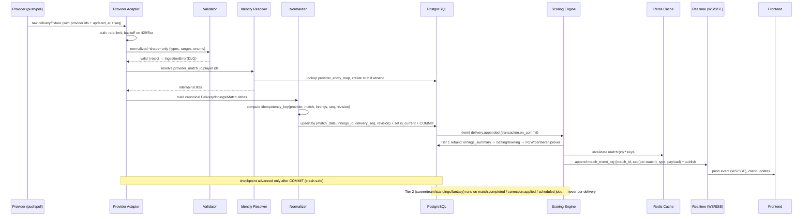

# CRICKET_DATA_INGESTION.md

Design of the licensed **data ingestion pipeline** that keeps Cricket OS in
sync with a commercial cricket data provider, plus the provider evaluation
matrix and the licensing verification checklist.

> **Non-negotiable:** all live scores, ball-by-ball, commentary and official
> rankings enter the platform through a **licensed provider**. Cricbuzz pages
> are used for *UX study only* and are **not** a data source. No scraping, no
> reuse of undocumented endpoints.

---

## 1. Provider evaluation matrix

Ratings are **planning placeholders** to structure evaluation, not facts. Every
cell marked "verify" must be confirmed contractually before selection.

| Provider | Type | Ball-by-ball | Push/WS | Historical depth | Commentary | Fantasy feed | IPL & leagues | Domestic | Licence/redistribution | Pricing | Notes |
|---|---|---|---|---|---|---|---|---|---|---|---|
| **Entity Sport** (Cricbuzz's B2B arm) | Managed | verify | verify | verify | verify | yes (advertised) | advertised (IPL, BBL, PSL, BPL, CPL) | advertised (First Class, List A) | verify | verify | Observed coverage claim on public site; note: some APIs (commentary/stats/wagon wheel) withdrawn from lower plans |
| **CricAPI / cricketdata.org** | Managed | paid tier | verify | verify | verify | verify | verify | verify | verify | free tier + paid | Free tier for basic scores; ball-by-ball on paid |
| **SportMonks** | Managed | yes (advertised) | verify | verify | verify | verify | verify | verify | verify | per-plan | Public fixture include set `runs,batting,bowling,lineup,balls,venue` observed |
| **Sportradar** | Managed (enterprise) | yes | yes | deep | yes | verify | yes | yes | enterprise licence | enterprise | Historical leader; enterprise cost/SLA |
| **Roanuz / Cricket API** | Managed | verify | verify | verify | verify | verify | verify | verify | verify | per-plan | — |
| **RapidAPI aggregators** | Aggregator | varies | varies | varies | varies | varies | varies | varies | varies | per-call | Fast start, weaker SLA/licensing clarity |
| **Cricsheet** | Open data | **yes** | no (static) | **~23,193 matches** | no | no | yes (T20 leagues) | partial | **ODC-By / CC-BY** (commercial + attribution) | free | Ideal for **historical backfill** & identifier register (incl. Opta `key_pulse`) |
| **Replay (internal)** | Internal / replay | yes (recorded) | n/a (recorded) | recorded corpus | n/a | no | n/a | n/a | **internal, test/dev only** (never redistributed) | free | `ReplayAdapter` feeds recorded Cricsheet matches through the live pipeline as a fake provider — unblocks Phases D/E before a live licence |

### 1.1 Licensing verification checklist (per provider)

Before contract/implementation, verify **in writing**:

- [ ] International coverage (Test/ODI/T20I, men & women).
- [ ] Domestic coverage (First Class, List A, T20) by region.
- [ ] IPL and other T20 league coverage.
- [ ] Live score **frequency** and latency SLA.
- [ ] Ball-by-ball availability and latency.
- [ ] Historical data depth and format.
- [ ] Player statistics and ranking feeds.
- [ ] **Corrections and cancellations** semantics (are revisions pushed?).
- [ ] API **rate limits** and burst allowances.
- [ ] **Commercial display rights** (web/mobile/CTV).
- [ ] **Redistribution rights** (can we expose to our users/APIs?).
- [ ] **Data retention** restrictions (must we delete after the match?).
- [ ] Pricing tiers, overage, and **SLA/uptime guarantees**.
- [ ] Whether **DLS/target** and **ICC rankings** are supplied.

**Open dependency:** provider selection cannot be finalised until these are
confirmed ([CRICKET_RISKS_AND_ASSUMPTIONS.md](CRICKET_RISKS_AND_ASSUMPTIONS.md)).

---

## 2. Integration model

- **Push preferred, polling supported.** Push (webhook/WS/SSE) gives lowest
  latency; polling (with `updated_since` cursors) is the universal fallback.
- **Adapter pattern.** Each provider implements a common interface; the domain
  never sees provider-specific shapes.

```python
class ProviderAdapter(Protocol):
    def list_fixtures(self, window: DateRange) -> Iterable[RawFixture]: ...
    def get_match(self, provider_match_id: str) -> RawMatch: ...
    def get_scorecard(self, provider_match_id: str) -> RawScorecard: ...
    def iter_deliveries(self, provider_match_id: str, since_seq: int | None) -> Iterable[RawDelivery]: ...
    def get_commentary(self, provider_match_id: str) -> Iterable[RawCommentary]: ...
    def get_rankings(self, gender: str) -> Iterable[RawRanking]: ...
    def normalize(self, raw) -> NormalizedRecord: ...
    def capabilities(self) -> ProviderCapabilities: ...
```

### 2.1 Replay adapter (internal, test/dev only)

`ReplayAdapter` implements the same `ProviderAdapter` interface but replays a
recorded **Cricsheet** match (or a captured fixture) through the *live* ingestion
→ scoring → realtime pipeline at a configurable rate. It is a **fake provider**:
its purpose is to let Phases D and E be built, exercised and load-tested before a
licensed live contract exists, and to drive the E2E lifecycle and realtime tests.
It is `internal, test/dev only` and its data is never redistributed. See
[CRICKET_IMPLEMENTATION_ROADMAP.md](CRICKET_IMPLEMENTATION_ROADMAP.md) (Phase D)
and [CRICKET_TESTING_STRATEGY.md](CRICKET_TESTING_STRATEGY.md).

> **Phase D implementation:** the adapter lives in
> `apps/providers/adapters/replay.py` with a deterministic virtual clock,
> fault injection (duplicate/delayed/reordered/dropped/correction/429/5xx/
> timeout/malformed/outage) and a hard `ENVIRONMENT=prod` guard; the reusable
> contract suite that every adapter must pass is
> `tests/contracts/provider_adapter_kit.py`. The full live-ingestion design —
> state machine, `apply_batch`, event log, polling/push, breaker +
> `meta.stale`, flags — is documented in
> [LIVE_INGESTION.md](LIVE_INGESTION.md).

---

## 3. Ingestion pipeline

```
Provider API / push feed
  → Provider adapter (auth, pagination, rate-limit, retries)
  → Schema validation (strict; contract-tested)
  → Identity resolution (provider id → internal uuid; create-if-missing)
  → Idempotent normalization (canonical domain records — deliveries *and* off-ball
    innings events — + idempotency key)
  → PostgreSQL persistence (transactional, upsert-by-revision; is_current flag)
  → Tier 1 rebuild (per delivery): innings_summary → cards → FOW/partnership/over
  → Redis cache invalidation (targeted match keys)
  → Real-time event publication (match_event_log + Redis pub/sub → WS/SSE)
  → Frontend update
  ... and, off the live path (not per delivery):
  → Tier 2 rebuild on match.completed / correction.applied / scheduled jobs:
      player_match_stat → career/team → standings/leaderboard/H2H/form → fantasy
```

Tier 1 runs on every append/correction and keeps the live scorecard fresh; Tier 2
never runs on a single delivery (see
[CRICKET_SCORING_RULES.md §6](CRICKET_SCORING_RULES.md)).

### 3.1 Sequence diagram (Mermaid)



---

## 4. Reliability engineering

### 4.1 Idempotency

- **Idempotency key** = `sha256(provider_code | match_provider_id | innings_number |
  delivery_seq | revision)` for deliveries; analogous keys for other entities.
  The business identity of a ball is `(match_date, innings_id, delivery_seq)`,
  with `revision` distinguishing corrections.
- Persist via `INSERT ... ON CONFLICT ... DO UPDATE` keyed by
  `ux_delivery_revision` (`match_date, innings_id, delivery_seq, revision`); the
  partial unique index `ux_delivery_current` enforces exactly one **current** row
  per ball, and the superseded row is flipped to `is_current=false` /
  `superseded_at=now()` in the same transaction. Other tables use
  `ux_match_provider`, etc. Replayed events are no-ops.
- **All reads and rebuilds filter `is_current = true`.**
- `ImportJob.idempotency_key` prevents duplicate job execution.

### 4.2 Duplicate-event prevention & out-of-order handling

- Every delivery carries a **monotonic `delivery_seq` per innings** and a
  `provider_updated_at`. The ingestion layer:
  - Rejects/queues events whose `seq` is **behind** the checkpoint unless it is a
    *correction* (`revision > current`).
  - Accepts gaps optimistically and lets the **reconciliation** job backfill
    missing sequences by re-fetching the innings (rather than assuming order).
  - Never relies on HTTP arrival order.
- Because scorecards/statistics are **rebuilt from stored deliveries**, an
  out-of-order arrival cannot corrupt the derived state — it only delays it.

### 4.3 Retry, backoff, dead-letter

- Celery tasks use **exponential backoff with jitter** (`retry_backoff=True`),
  bounded attempts (e.g. 8), honouring `Retry-After` on `429`.
- Permanent failures (validation, unresolvable identity, schema drift) go to the
  **`IngestionError` dead-letter table** with stage, payload, and class; an ops
  dashboard surfaces unresolved rows.
- Transient provider outages degrade gracefully: serve last-known-good from
  Redis/DB and mark `meta.stale=true`.

### 4.4 Provider outage & partial data

- Circuit breaker per provider endpoint; on open, stop polling that endpoint and
  rely on cache; alert ops.
- **Partial updates** are applied field-by-field; missing fields are simply not
  updated (never overwritten with null).

### 4.5 Corrections & reschedules

- **Corrections** create a `DataCorrection` row and append a new `revision` for
  the affected delivery (previous row marked `is_current=false`); the pipeline
  re-runs Tier 1 (scorecard) immediately and Tier 2 (career/team/standings/
  fantasy) off the live path, then publishes `correction.applied`.
- **Reschedules** update `match.start_time_utc`/`source_local_date` and emit
  `match.updated`; downstream caches are invalidated by date-bucket keys.

### 4.6 Reconciliation

- **Checkpoint reconciliation:** periodically compare `SyncCheckpoint.last_delivery_seq`
  with the provider's innings length; if behind, backfill.
- **State reconciliation:** for completed matches, fetch the provider's final
  scorecard and diff against our rebuilt figures; differences create a
  `ReconciliationJob` and, once confirmed, a `DataCorrection`.
- **Standings/points** reconciliation after each match day.

### 4.7 Restart safety

Because checkpoints advance only **after commit**, and because derived state is
rebuildable from canonical deliveries, the pipeline can restart at any moment:
it resumes from the last committed checkpoint and any in-flight events are
re-processed idempotently. No match event is lost or double-applied.

---

## 5. Observability

| Signal | Tool / metric |
|---|---|
| Ingestion lag | `provider_lag_seconds` = now − `last_event.provider_updated_at` |
| Throughput | deliveries/min, jobs/min per provider |
| Error rate | `ingestion_errors_total{stage}`; DLQ depth |
| Idempotency | duplicate-suppressed counter |
| Freshness | `match_freshness_seconds{match_id}` (live matches) |
| Realtime | WS connections, events/sec, reconnect rate |
| Data quality | fixtures missing venue/status; deliveries with impossible runs |
| Provider health | per-endpoint latency/5xx, circuit-breaker state |

**Alerts:** lag > 60 s on a live match; DLQ growth; correction rate spike;
schema-drift validation failures; reconciliation mismatch on a completed match.

---

## 6. Data-quality rules applied at the boundary

- Enums validated against the canonical sets; unknown values quarantined, not
  dropped silently.
- Runs constrained (`0 ≤ runs_off_bat ≤ 6`, wides ≥ 0, etc.).
- `delivery_seq` strictly increasing per innings (gaps allowed, duplicates
  rejected).
- `wicket ⇒ dismissal_type & dismissed_player_id` present (schema CHECK).
- `retirement_type ⇒ retired_player_id` present and `is_wicket=false` (schema
  CHECK); retirements (`HURT`/`NOT_OUT`) never carry a `dismissal_type`.
- **Retirement routed to exactly one source.** A retirement that coincides with a
  delivery (the provider gives a ball for it) is normalised onto that `delivery`
  (`retired_player_id` + `retirement_type`). A retirement with **no ball** — a
  rain/drinks/innings break, before the first delivery, or an innings that never
  resumes — is normalised into `innings_event`
  (`event_type='RETIREMENT_HURT'|'RETIREMENT_NOT_OUT'`, `anchor_delivery_seq=NULL`
  or the delivery after which it applies). The normalizer must never write the
  same retirement to **both**; a boundary check fails the batch if a delivery
  retirement and an `innings_event` retirement match on `(innings, player, anchor)`.
  `innings_event` idempotency mirrors deliveries: key
  `sha256(provider_code | match_provider_id | innings_number | event_type |
  coalesce(player_id,∅) | coalesce(anchor_delivery_seq,-1) | revision)`, upserted
  against `ux_innings_event_revision` with exactly one `is_current` row.
- Timestamps normalised to UTC; source local date/time preserved.
- Player/team/venue resolved to internal UUIDs or stubbed and flagged for
  steward review (`provider_entity_map.verified=false`).
