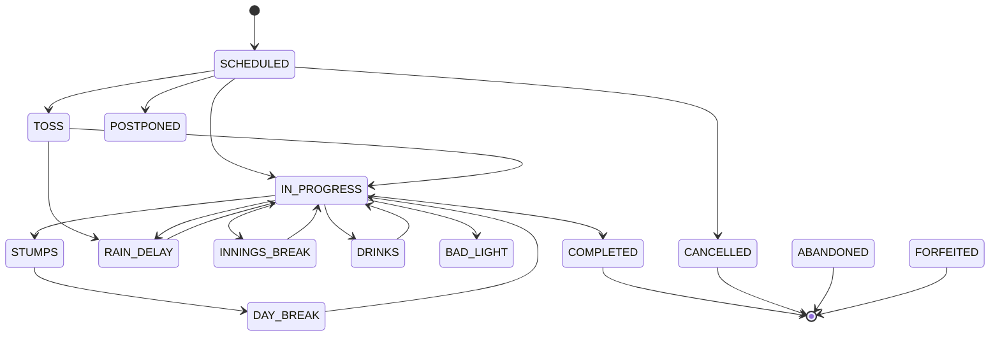

# Live ingestion

How Cricket OS gets live fixtures, match state and ball-by-ball deliveries from
a provider into the domain, keeps them correct under provider failures, and
publishes a durable, ordered event stream for consumers. This is the Phase D
implementation companion to [CRICKET_DATA_INGESTION.md](CRICKET_DATA_INGESTION.md)
(surface contracts) and [CRICKET_SECURITY_AND_RELIABILITY.md](CRICKET_SECURITY_AND_RELIABILITY.md)
(failure recovery, licensing). Runbooks live in [RUNBOOKS.md](RUNBOOKS.md).

```mermaid
flowchart LR
    subgraph Providers
        P1[Licensed provider]
        RP[ReplayAdapter]
    end

    subgraph "Live ingestion surface (apps/live)"
        FX[fixture sync]
        PO[pooling dispatcher]
        PU[push receiver]
        BR[circuit breaker]
    end

    subgraph "Domain write path"
        AL[per-match advisory lock]
        AB[apply_batch]
        EV[event log]
        RB[Tier-1 rebuild]
        SV[shadow verify]
    end

    P1 --> PO
    P1 --> PU
    RP --> PO
    PO --> BR --> AL --> AB --> EV
    PU --> AL
    AB --> RB --> SV
    EV --> REDIS[(Redis match:{id})]
    EV --> DB[(match_event_log)]

    DB --> API[/matches/live|recent|upcoming/]
    API --> META[meta.stale, attribution]
```

## 1. Architecture summary

| Concern | Where | Notes |
|---|---|---|
| Lifecycle state machine | `apps/matches/services/state.py` | explicit transition table, audited events |
| Durable event log | `MatchEventLog` + `apps/matches/services/event_log.py` | per-match gapless `seq` under advisory lock |
| Redis publication | `apps/matches/services/publication.py` | best-effort after commit; the log is the source of truth |
| Live write path | `apps/live/services/apply.py` | `apply_batch`: idempotent append/revise + per-innings rebuild |
| Shadow verification | `apps/live/services/verify.py` | digest comparison, heal, DLQ reporter (inverted) |
| Results | `apps/matches/services/result_service.py` | single `match.completed`, margins, DLS only from provider |
| Fixture sync | `apps/synchronization/services/fixtures.py` | idempotent upsert; reschedule/cancel; never delete |
| Polling + breaker + backoff | `apps/live/services/{polling,breaker,backoff}.py` | TTL lock, adaptive cadence, `meta.stale` |
| Push receiver | `apps/live/services/receiver.py` | flag-gated HMAC webhook |
| Licensing | `apps/providers/licensing.py` | `LICENSED_CONTENT_POLICIES`, retention dry-run |
| Replay fake provider | `apps/providers/adapters/replay.py` | virtual clock + fault harness, `ENVIRONMENT=prod` guard |

**Phase 0 gate:** `docs/PROVIDER_DECISION.md` is **absent** — no licensed
provider is wired. The `ReplayAdapter` is the only registered adapter
(`providers` app `ready()`); a future adapter must implement the same
`ProviderAdapter` protocol and pass `tests/contracts/provider_adapter_kit.py`.

## 2. Match lifecycle state machine

`match.status` is **lifecycle only** — the outcome lives in
`result_type`/`match_result`. Transitions go through the explicit table
(`ALLOWED_TRANSITIONS`); re-applying the current state is an idempotent no-op;
any other move raises `IllegalTransition`. Every transition appends a
`match.state_changed` event and updates `state_title`/`status_detail`
("Day 4 — Tea", "Rain delay").



Terminal states (`COMPLETED`, `ABANDONED`, `CANCELLED`, `FORFEITED`) have no
automatic outgoing transition. A steward may **reopen** a completed match
(audited `match.reopened`); corrections on a completed match keep it
`COMPLETED` and re-derive rows in place.

## 3. The live write path (`apply_batch`)

`apply_batch(match, batches, ...)` is the single writer. It runs inside the
**per-match transaction-scoped advisory lock** (`pg_advisory_xact_lock` keyed
on the match UUID), so concurrent polls/pushes serialize and the event log
stays gapless.

1. **Normalize** `LiveInningsBatch` records (innings number + `DeliveryDraft`s).
2. **Append/revise** each delivery through the Phase C write path: new
   `delivery_seq` rows are appended; a re-delivered seq with `revision=2` is a
   **correction** (`is_current=false` supersession + `delivery.corrected`).
   Duplicates are no-ops.
3. **Rebuild** the affected innings' Tier-1 rows from stored current deliveries
   (there is deliberately no incremental `apply_delivery` — SCORING_ENGINE_API
   §7; a full rebuild is ~3 ms/300 balls). Tier-2/career aggregates are never
   touched by the live path.
4. **Transition** state if the payload says so (only via the transition table).
5. **Stamp** `last_ingested_at` only when something changed — an empty poll must
   not mask provider lag.
6. **Append events** (`delivery.appended`, `innings.updated`,
   `match.state_changed`, `match.completed`) to `match_event_log` and publish
   to Redis after commit (best-effort).

`ApplyReport` returns per-batch counts (`appended`/`corrected`/`noop`),
`changed`, innings digests and the checkpoint seq, so callers can advance
`SyncCheckpoint.last_delivery_seq` and adapt poll cadence.

### 3.1 Shadow verification

Because rebuild is already a full recomputation, "shadow verify" runs a second,
independent comparison of persisted rows against a fresh engine rebuild every
`LIVE_SHADOW_VERIFY_EVERY` batches (and at innings end). On mismatch it heals by
rebuilding again, bumps `shadow_verify_mismatches_total` and writes a redacted
`IngestionError` (`stage=shadow_verify`) via the reporter registered by
`apps.ingestion` (dependency inversion — `apps.live` never imports the DLQ
writer directly).

## 4. Durable event log

`match_event_log` is the **source of truth for realtime** (WS/SSE consumers
arrive in Phase E). Rows are sequenced per match via the advisory lock
(`UNIQUE(match_id, seq)`, gapless by construction — a rolled-back transaction
leaves no gap and no counter row to drift).

| Event | Payload highlights |
|---|---|
| `match.state_changed` | `from`, `to`, `state_title`, `status_detail`, `reopened`, `source` |
| `match.updated` | `fields` (ISO-encoded), `reason`, `source` |
| `match.completed` | result summary; fires exactly once |
| `innings.updated` | `runs`, `wickets`, `overs_display`, `digest` |
| `delivery.appended` / `delivery.corrected` | `innings_id`, `delivery_seqs`, `revision` |
| `scorecard.updated` | rebuilt card revision |
| `correction.requested` / `correction.applied` | entity + scope |

Publication to Redis (`match:{id}`) runs in `transaction.on_commit` and is
**best-effort**: a failed publish increments `event_publish_failures_total` and
logs, but the row is already durable — consumers resync via
`events_since(match, seq)` / `resync_required`. Retention prunes terminal
matches only after `LIVE_EVENT_RETENTION_HOURS`.

## 5. Ingestion surfaces

### 5.1 Fixture sync

`apps/live/services/fixture_sync.py` → `sync_fixtures` (in `synchronization`,
which owns the audit discipline). Each adapter `list_fixtures(window)` result is
folded idempotently keyed on `(source_provider_id, provider_match_id)`:

- **created** → new `Match` + `MatchTeam` rows (team upsert by registry id or
  normalised name);
- **rescheduled** (start moved) / **updated** → `match.updated` event with the
  changed fields;
- **cancelled** → lifecycle transition (only if `can_transition`);
- **never deleted** — a fixture missing from a later window is a
  reconciliation concern, not a deletion.

Entry points: `live.sync_fixtures` beat task, `manage.py sync_fixtures`,
both gated on `LIVE_INGESTION_ENABLED`. Rejected records land on the redacted
`IngestionError` DLQ (`stage=fixture_sync`).

### 5.2 Polling

`dispatch_polls` (beat task `live.dispatch_polls`) polls every match in the
live status set (oldest `last_ingested_at` first). Each poll cycle:

1. Redis TTL poll lock (`LIVE_POLL_LOCK_TTL_SECONDS`) de-duplicates concurrent
   polls (correctness does not depend on it — the advisory lock + idempotency
   do the real work);
2. resumes from `SyncCheckpoint.last_delivery_seq` for `match:{id}`;
3. fetches `since_seq` → `apply_batch` → advances the checkpoint only when
   changed;
4. an **open breaker** skips the fetch entirely and the poll reports
   `skipped_reason="breaker_open"`, `stale=True`.

Adaptive cadence (`cadence_for`): faster while play is in progress, slower in
breaks/toss/rain (configurable floor `LIVE_POLL_INTERVAL_SECONDS`).

### 5.3 Push receiver

`POST /ingest/live/push` (outside the public router) accepts a provider
webhook, validates the `X-Signature` HMAC (`LIVE_PUSH_HMAC_SECRET`,
`LIVE_PUSH_REPLAY_WINDOW_SECONDS` anti-replay), and enqueues the payload through
the **identical** `apply_batch` pipeline. Gated on `LIVE_PUSH_RECEIVER_ENABLED`
(404 otherwise); unconfigured secrets return `503 receiver not configured`.

### 5.4 Circuit breaker + `meta.stale`

A `CircuitBreaker` per provider endpoint (failure threshold, half-open probe,
recovery timeout — all configurable) is registered in a small registry so
readers can observe it. When a breaker is OPEN:

- polls are skipped (never hammer a failing provider);
- `/matches/live|upcoming|recent` still serve last-known-good with
  `meta.stale=true` on the affected items (SECURITY §8: a provider failure
  never blocks reads);
- the `circuit_breaker_state{provider,endpoint}` gauge feeds the
  `CircuitBreakerOpen` alert.

## 6. Adapter contract & the ReplayAdapter

Every provider adapter implements `apps.providers.base.ProviderAdapter`
(`list_fixtures`, `get_match`, `get_scorecard`, `iter_deliveries`,
`get_commentary`, `get_rankings`, `normalize`, `capabilities`) and must pass
`tests/contracts/provider_adapter_kit.py` — the reusable suite that pins the
exact shapes the live path consumes:

- `list_fixtures` yields `FixtureRecord`s;
- `get_state`/`get_match` return a `LiveState`;
- `iter_deliveries` yields `LiveInningsBatch` records with **per-innings**
  monotonic `delivery_seq` and correct `since_seq` resume semantics;
- `get_scorecard` returns the provider card shape.

The **ReplayAdapter** replays a recorded Phase C match through the live
pipeline as a fake provider (Phase 0 gate: no licensed adapter). It features a
deterministic `ReplayClock` (explicit `advance`, `speed` multiplier, opt-in
pacing) and a `ReplayFaults` harness covering the reliability matrix:
duplicate, delayed, reordered, dropped, correction-after-completion, `429`
Retry-After, `5xx`, timeout, malformed payloads, unknown status, an outage
window and per-call virtual delay. It refuses to construct when
`ENVIRONMENT=prod` — recorded data is internal and never redistributed.

## 7. Corrections, reconciliation, licensing

- **Corrections** (`correction.applied`): a steward-confirmed revision supersedes
  the wrong deliveries (`is_current=false`), bumps the match revision, and
  re-derives in place; the strong ETag changes automatically so caches and
  clients pick it up.
- **Reconciliation** (`apps/synchronization/services/reconciliation.py`):
  checkpoint/gap, provider-vs-engine state, and fixture-window comparisons
  surface as `ReconciliationJob`s + redacted DLQ rows; mismatches are **never
  auto-corrected silently**.
- **Licensing** (`apps/providers/licensing.py`): `LICENSED_CONTENT_POLICIES` is
  configuration, not code. `check_license` raises `403 license_required` for
  unlicensed features; `attribution_for`/`license_meta` feed API `meta`;
  `enforce_retention` enforces per-provider ball-data windows (dry-run by
  default; keeps derived summaries).

## 8. Configuration flags

| Flag | Default | Effect |
|---|---|---|
| `LIVE_INGESTION_ENABLED` | `false` | master switch for fixture sync + polling tasks |
| `LIVE_PUSH_RECEIVER_ENABLED` | `false` | serve `POST /ingest/live/push` |
| `LIVE_PUSH_HMAC_SECRET` | — | shared webhook secret (never logged) |
| `LIVE_PUSH_REPLAY_WINDOW_SECONDS` | `300` | webhook anti-replay window |
| `LIVE_POLL_INTERVAL_SECONDS` | — | adaptive-cadence floor |
| `LIVE_POLL_LOCK_TTL_SECONDS` | — | Redis poll lock TTL |
| `LIVE_FRESHNESS_STALE_SECONDS` | — | freshness monitor threshold |
| `LIVE_SHADOW_VERIFY_EVERY` | — | shadow-verify cadence (batches) |
| `LIVE_EVENT_RETENTION_HOURS` | — | event-log retention after completion |
| `LIVE_RECONCILIATION_WINDOW_HOURS` | — | post-completion reconciliation window |
| `LIVE_BREAKER_*` | — | breaker thresholds / recovery |
| `ENVIRONMENT` (`DJANGO_ENVIRONMENT`) | `dev` | `prod` blocks the ReplayAdapter |
| `LICENSED_CONTENT_POLICIES` | `{replay}` | per-provider licence config |
| `ENABLE_METRICS_ENDPOINT` | `false` | serve internal `/metrics` exposition |

## 9. Metrics & alerts

`apps/core/metrics.py` is a facade over `prometheus_client` (in-process
fallback with the same names in this offline image) exposing:
`match_freshness_seconds`, `provider_lag_seconds`, `deliveries_per_minute`,
`dlq_depth`, `ingestion_errors_total{stage}`, `circuit_breaker_state`,
`shadow_verify_mismatches_total`, `event_publish_failures_total`,
`event_log_lag`, `ingest_to_event_log_seconds`, `corrections_total`,
`duplicate_suppressed_total`. Alert rules in `ops/alerts/live_alerts.yml` map
1:1 to runbooks in [RUNBOOKS.md](RUNBOOKS.md).
